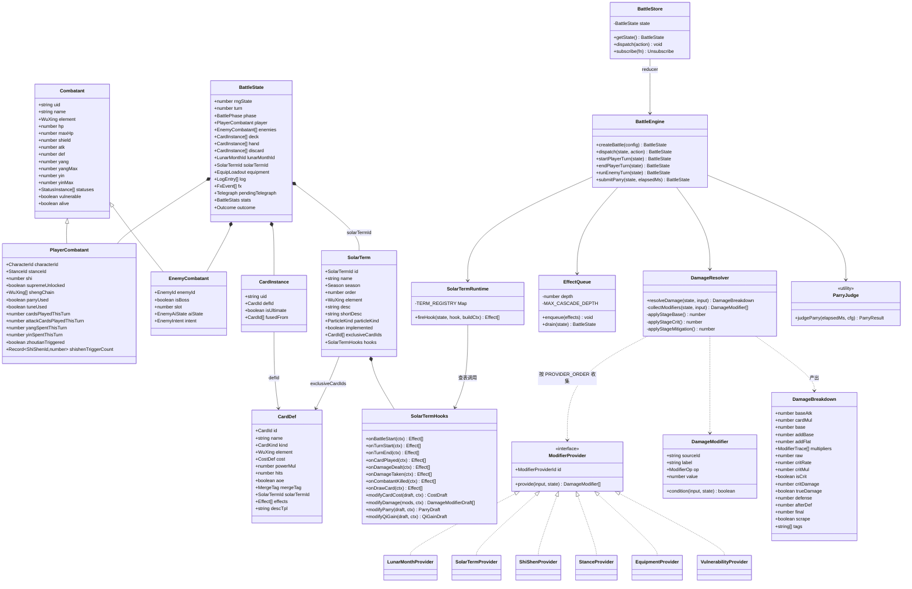
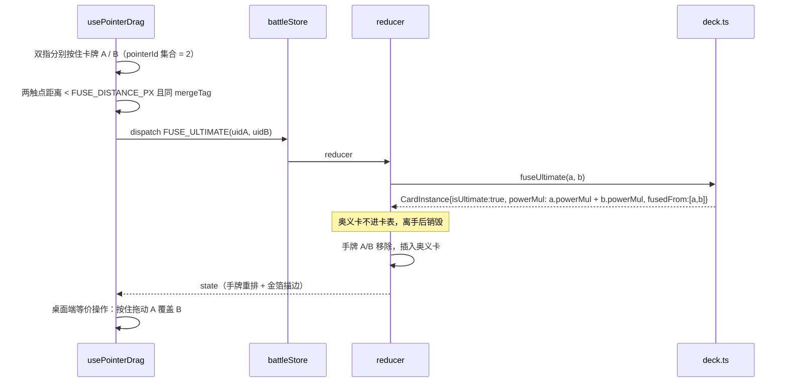
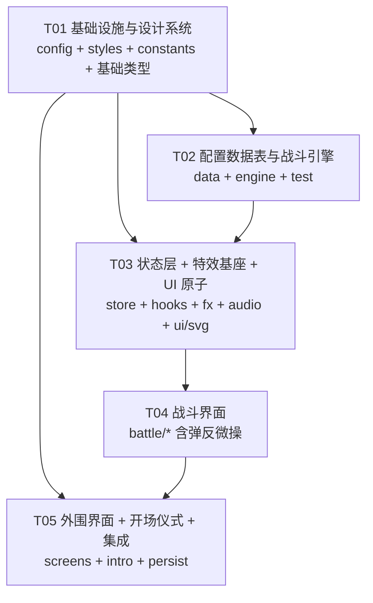

# 《炁渊 · QI ABYSS》系统架构设计

| 项目 | 内容 |
|------|------|
| 文档版本 | v1.0 |
| 作者 | 高见远（Gao）· Architect |
| 上游输入 | `docs/PRD.md` v1.0（许清楚） |
| 目标平台 | 手机浏览器竖屏 390×844（9:16），桌面居中 390px 容器 |
| 技术栈 | Vite 8 + React 19 + TypeScript 6 + Tailwind CSS v4 + Vitest |
| 后端 | 无。纯前端单机，localStorage 持久化（`v1_` 前缀） |
| 美术资源 | **零**。SVG path / Canvas 粒子 / Web Audio 全部程序化 |

---

## 1. 实现方案与框架选型

### 1.1 核心技术挑战

| # | 挑战 | 架构对策 |
|---|------|---------|
| C1 | **五层变量（月令→炁候→十神→架势→装备）叠加后的结算正确性** | 统一修饰器链 + 单一 `resolveDamage` 管线，全部修正以 `DamageModifier[]` 声明式表达（§2） |
| C2 | **24 节气槽位预留，新增节气必须零改引擎** | 节气 = 纯数据 + 声明式 hooks，hooks 只返回 `Effect[]`，引擎查表调度（§3） |
| C3 | **"回合制里的动作游戏"——0.6s 弹反窗口的手感与判定的可测性** | 判定逻辑下沉为纯函数 `judgeParry(elapsedMs)`，UI 只负责报时间戳（§4.4） |
| C4 | **高复杂度战斗状态 + 60fps 特效并存** | 战斗状态（低频离散更新）与特效层（Canvas/RAF，不入 React 状态）严格分离（§1.4） |
| C5 | **零素材下"新中式绮丽"与五正色纪律** | 颜色唯一来源是 `tokens.css` 的 CSS 变量；Tailwind 清空默认色板只注册 8 个 Token（§9.3） |
| C6 | **"失令"分支 MVP 跑不到但必须正确** | 失令逻辑为配置驱动，单测直接构造木行角色 + 木旺月令强制覆盖（§2.7） |

### 1.2 状态管理：**自建极简 Store（useSyncExternalStore）**

| 方案 | 评估 | 结论 |
|------|------|------|
| `useReducer` + Context | reducer 天然纯函数 ✅；但 Context 全树重渲染，手牌 5 张 + 3 敌人 + 特效事件会造成明显掉帧 | ❌ |
| `zustand` | 体积小、选择器订阅，接近理想 | ⚠️ 但我们要的只是"一个纯 reducer + 少数字段订阅"，引入依赖收益低；且 zustand 允许在任意处直接 `set`，容易诱导工程师绕过纯函数结算 |
| **自建 `createStore` + `useSyncExternalStore`** | ~60 行；reducer 完全独立于 React，可在 Vitest 中脱离 DOM 直接调用；`useStore(selector)` 精确订阅；零依赖 | ✅ **采用** |

**关键分层**：

```
React 组件 ──dispatch(Action)──▶ createStore ──▶ battleReducer(纯函数) ──▶ 新 BattleState
    ▲                                                    │
    └─────────── useSyncExternalStore(selector) ─────────┘
```

- `battleReducer(state, action) → state` **不 import 任何 React**，不调用 `Date.now()` / `Math.random()`（随机走 `state.rngState`），因此**完全可单测、可录像回放**。
- 时间相关的敌前摇（0.9s）由 UI 侧 RAF 驱动，仅在结算时把 `elapsedMs` 作为 Action payload 交回引擎。

### 1.3 动画方案：**CSS 关键帧 + Pointer Events + 手写 RAF，不引入动画库**

| 场景 | 方案 | 理由 |
|------|------|------|
| 手牌扇形排布、选中上浮、敌方回合手牌下沉 | CSS `transform` + `transition` | GPU 合成层，390px 下零成本 |
| 伤害数字爆裂、水墨字、金箔闪光 | CSS `@keyframes`（`scale(0.2)→1.3→1`） | 声明式，可复用 |
| 格挡判定条收缩 | 手写 RAF（`useRaf`）+ `transform: scaleX()` | 需要精确 ms 读数回传引擎，动画库反而碍事 |
| 墨染金箔粒子、节气物候 | Canvas 2D + RAF，粒子池上限 200 | 唯一 60fps 部分，完全在 React 之外 |
| 卡牌拖拽 + **双指合并奥义卡** | 原生 Pointer Events（`pointerdown/move/up` + `pointerId` 集合） | **决定性理由**：Framer Motion 的 drag 手势不支持多指合并，而奥义卡是 P0-15。必须手写 |
| 卡帧 Hitstop | 全局 CSS class `body.hitstop` + 屏幕抖动 keyframes | 不阻塞 RAF，最简单 |

**结论：不引入 Framer Motion**（~50KB，且核心手势需求它满足不了）。

### 1.4 是否引入 Tailwind：**是（v4，仅作色板与间距 Token）**

- 采用 **Tailwind CSS v4 + `@tailwindcss/vite`**（CSS-first，无需 `tailwind.config.js`）。
- 在 `tokens.css` 中用 `@theme { --color-*: initial; --color-zhuhong: #C23B22; ... }` **清空默认色板**，只注册 PRD §5.0 的 8 个色。这样 `text-red-500` 这类默认色**根本不存在**，从工具层面杜绝荧光色。
- 所有 hex **只允许出现在 `src/styles/tokens.css`**。Canvas 粒子通过 `getComputedStyle(document.documentElement).getPropertyValue('--color-zhuhong')` 读取，避免二次硬编码。

### 1.5 是否引入 MUI：**否**（架构师对 PRD 的一处明确否决）

PRD §1 技术栈写了 MUI，但**工程上应否决**，理由：

1. **与设计目标直接冲突**。MUI 是 Material Design 语言（圆角、Roboto、扁平投影、蓝灰主色），与 G3「新中式绮丽」背道而驰。本项目 UI 全部是自定义 SVG 剪影、印章、毛笔字、水墨条——MUI 提供的 Button/Input/Card 无一可用，每个都要 `sx` 深度覆写，净代码量反而上升。
2. **体积与竖屏性能**。MUI + Emotion ~300KB+，运行时 CSS-in-JS 在低端安卓上有明显样式注入开销。
3. **本项目只有 4 个界面**，UI 原子组件（Button / Panel / Seal / BrushText / QiBar / HpBar）自己写约 200 行，可控且风格一致。

> ⚠️ 此项偏离 PRD 原文，需 PM/主理人确认。若坚持保留 MUI，我将改为"仅引入 `@mui/material` 的 `Button/Modal` 两个组件"的折中方案，但强烈不建议。

### 1.6 架构模式：**分层 + 事件溯源式特效队列**

```
┌─────────────────────────────────────────────────────────┐
│  L4 表现层  components/  fx/  audio/   (React + Canvas)  │
├─────────────────────────────────────────────────────────┤
│  L3 适配层  store/  hooks/             (useSyncExternal) │
├─────────────────────────────────────────────────────────┤
│  L2 引擎层  game/engine/               (纯 TS，零 React) │
│             battle.ts damage.ts cost.ts qi.ts ...        │
├─────────────────────────────────────────────────────────┤
│  L1 数据层  game/data/  game/types/  game/constants/     │
│             (纯配置表 + 类型 + 常量，零逻辑)              │
└─────────────────────────────────────────────────────────┘
```

**依赖方向严格单向向下**：L4 可 import L1/L2/L3；**L2 禁止 import L3/L4**（用 lint 约定 + code review 保证，不引入 eslint-plugin-boundaries 以免增加配置负担）。

---

## 2. 核心架构决策：战斗结算管线

> 这是全篇最重要的章节。所有战斗数值**必须**且**只能**通过本管线产出。

### 2.1 铁律：基础值是乘法基数，其余一律倍率

PRD §3.1 要求「`(基础攻击 × 架势倍率 × 节气修正 × 月令修正) - 敌方防御`」，且「任何 DOT/冰冻/连击/异常的触发都不允许绕过这个乘法基数」。

架构上用**类型系统**强制：

- **整个代码库中，`base` 的加法只允许发生在两处**：
  1. `baseAtk = 角色.baseAtk + 兵刃.atkBonus`（角色与武器，进 `baseAtk`）
  2. `base = ceil(baseAtk × cardMul)`（卡牌倍率）
- **其余所有修正是且仅是 `mul` 乘数**。若某效果需要固定值（如赤焰斩的灼烧 DOT），它走的是**独立的 `Effect` 通道**（`{type:'damage', amount}` 声明式，不进 `base`），见 §2.6。
- `DamageModifier.op` 只有 `'addBase' | 'addFlat' | 'mul'` 三种，`addBase` **仅 equipment provider 可用**（运行时断言）。

### 2.2 修饰器（Modifier）模型

```ts
// src/game/engine/modifiers.ts
export type ModifierOp = 'addBase' | 'addFlat' | 'mul';

export interface DamageModifier {
  sourceId: string;   // 'equipment.tangdao' | 'stance.tixiu' | 'term.jingzhe' | 'month.shen' | 'shishen.qisha'
  label: string;      // '破军·真伤' —— 复盘页与 tooltip 显示
  op: ModifierOp;
  value: number;      // addBase/addFlat 为绝对值；mul 为倍率（1.0 = 无变化）
  condition?: (input: DamageInput, state: Readonly<BattleState>) => boolean;
}

/** 一个变量层 = 一个 provider。纯函数，无副作用，返回本层贡献的修正。 */
export interface ModifierProvider {
  id: ModifierProviderId;
  provide(input: DamageInput, state: Readonly<BattleState>): DamageModifier[];
}

export type ModifierProviderId =
  | 'lunarMonth'    // 第一层 月令
  | 'solarTerm'     // 第二层 炁候
  | 'shiShen'       // 第三层 十神
  | 'stance'        // 第四层 架势
  | 'equipment'     // 第五层 装备
  | 'vulnerability' // 破绽/易伤（目标侧）
  ;

/** 收集顺序 = PRD 五层顺序。仅用于 UI 展示与 label 稳定排序 —— mul 乘法可交换，顺序不影响数值。 */
export const PROVIDER_ORDER: readonly ModifierProviderId[] = [
  'lunarMonth', 'solarTerm', 'shiShen', 'stance', 'equipment', 'vulnerability',
];
```

> **一个重要性质**：因为全部修正是乘法（`mul`），五层的**计算顺序与结果无关**。所以「五层顺序」只影响 ① UI 复盘展示顺序 ② 同为 `addFlat` 时的稳定排序 ③ hook 触发顺序。**这消除了五层联动最麻烦的一类 bug。**

### 2.3 五层变量的介入环节总表

| 层 | Provider | 介入的结算环节 | 典型修正 |
|---|---------|--------------|---------|
| 一 · 月令 | `lunarMonth` | `resolveDamage`(mul) / `resolveCardCost`(add) / `onTurnStart`(回炁) | 申月金旺：物理 `×1.25`、木行术法 `×0.8`；得令 `×1.10` + 每回合 +1阳+1阴；**失令**：首张牌 `cost +1`、暴击率 `-10%` |
| 二 · 炁候 | `solarTerm` | **全部 hooks**（`modifyDamage` / `modifyCardCost` / `onTurnStart` / `onTurnEnd` / `onDamageDealt` / `modifyParry` …） | 惊蛰：首张攻击牌 `×1.5` 且该牌消耗 `×2`；大雪：`modifyParry` 强制 `'parry'` |
| 三 · 十神 | `shiShen` | `resolveDamage`(mul) / `resolveCardCost`(mul) / `onKill` / `onDamageDealt` / 受击锁血 | 七杀：击杀后本回合剩余牌 `cost ×0.5`；伤官：暴击伤害 `setCrit 2.0`；杀身成仁：`×1.3` |
| 四 · 架势 | `stance` | `resolveDamage`(mul) / `resolveCardCost`(mul) / `onTurnStart` / `onCardPlayed` | 体修：`× (1 + 0.08 × 势层数)`，10 层破军 → 真伤；法修：相生链 `×1.1^n` 且 `cost ×0.5`；散修：阴阳差 → 暴击率/暴伤 |
| 五 · 装备 | `equipment` | `baseAtk`(**唯一 addBase**) / 附魔 Effect / 炁上限 / 招式重命名 | 唐刀 `addBase +18`；离火镜 阳炁上限 +3、命中追加灼烧 Effect |
| 目标侧 | `vulnerability` | `resolveDamage`(mul + `forceTrueDamage`) | 破绽：首张攻击牌 `guaranteedCrit = true` 且 `trueDamage = true` |

### 2.4 伤害主管线（7 阶段）

```ts
// src/game/engine/damage.ts
export interface DamageInput {
  attackerUid: string;
  defenderUid: string;
  card?: CardInstance;      // 弹反追击 / DOT 时为 undefined
  hitIndex: number;         // 多段中的第几段（0-based）
  hitCount: number;
  isRiposte: boolean;       // 弹反追击：atk × 0.5
  isUltimate: boolean;      // 奥义卡：×1.5
  guaranteedCrit: boolean;  // 破绽
  forceTrueDamage: boolean; // 破军 / 开天
  weaponElement?: WuXing;   // 阴阳合契附魔后的五行标签（仅影响 UI 配色与相克判定）
}

export interface DamageBreakdown {
  baseAtk: number;      // 角色基础攻击 + 兵刃
  cardMul: number;
  base: number;         // ★ 乘法基数 = ceil(baseAtk × cardMul)
  addBase: number;      // 仅装备固定值
  addFlat: number;
  multipliers: { sourceId: string; label: string; value: number }[];
  raw: number;          // (base + addBase + addFlat) × Π multipliers
  critRate: number;
  critMul: number;
  isCrit: boolean;
  critDamage: number;
  trueDamage: boolean;
  defense: number;
  afterDef: number;
  shieldAbsorbed: number;
  final: number;
  scrape: boolean;      // true = 攻击 ≤ 防御阈值，触发"刮痧"下限
  tags: string[];       // ['physical','fire'] → UI 决定数字颜色
}

export function resolveDamage(
  state: Readonly<BattleState>,
  input: DamageInput,
): { breakdown: DamageBreakdown; rngState: number }   // ← 纯函数，不修改 state
```

**阶段划分**：

```
S1 取基数      baseAtk = atk(player) + Σ equipment.addBase            [加法唯一发生地]
S2 卡牌倍率    cardMul = card.powerMul × (isUltimate ? 1.5 : 1)
               base    = ceil(baseAtk × cardMul)
S3 收集修正    mods = PROVIDER_ORDER.flatMap(id => PROVIDERS[id].provide(input, state))
               过滤 condition 为 false 的项
S4 分项应用    addBase/addFlat 求和；mul 连乘（顺序无关）
               raw = round((base + addBase + addFlat) × Π mul)
S5 暴击        critRate = clamp(0.05 + ΣcritRateDelta, 0, 1)   // 基础 5%
               critMul  = 1.5（默认）→ 伤官 2.0 → 霜降 set 1.5
               isCrit   = guaranteedCrit || nextFloat(rng) < critRate
               critDamage = round(raw × (isCrit ? critMul : 1))
S6 减伤        if (trueDamage) afterDef = critDamage
               else if (critDamage - def >= SCRAPE_MIN_ABS) afterDef = critDamage - def
               else { afterDef = max(1, round(critDamage × 0.1)); scrape = true }   ← 「刮痧」
S7 护盾/结算   shieldAbsorbed = min(shield, afterDef); final = afterDef - shieldAbsorbed
               clamp final ≥ 0
```

> `SCRAPE_MIN_ABS = 5`（`src/game/constants/balance.ts`）。「刮痧」分支的数学意义：当 `def ≥ raw` 时，无论叠多少层数，最终伤害被压到 `raw × 10%` —— 这正是「性命双修」铁律的代码表达。

### 2.5 伪代码：主管线

```
function resolveDamage(state, input) {
  const atk = getCombatant(state, input.attackerUid)
  const def = getCombatant(state, input.defenderUid)

  // S1
  const equipMods = PROVIDERS.equipment.provide(input, state)
  const baseAtk   = atk.atk + sumBy(equipMods, m => m.op === 'addBase' ? m.value : 0)

  // S2
  const cardMul = (input.card ? cardDef(input.card).powerMul : RIPOSTE_MUL)
                * (input.isUltimate ? ULTIMATE_MUL : 1)
                * (input.hitCount > 1 ? MULTI_HIT_MUL[input.hitCount] : 1)
  const base = Math.ceil(baseAtk * cardMul)

  // S3
  const mods = PROVIDER_ORDER.flatMap(id => PROVIDERS[id].provide(input, state))
                              .filter(m => m.condition ? m.condition(input, state) : true)

  // S4
  const addFlat = sumBy(mods, m => (m.op === 'addFlat' ? m.value : 0))
                  + sumBy(equipMods, m => m.op === 'addFlat' ? m.value : 0)
  const muls    = mods.filter(m => m.op === 'mul')
  const raw     = Math.round((base + addFlat) * muls.reduce((a, m) => a * m.value, 1))

  // S5
  let critRate = BASE_CRIT_RATE + sumCritRateDeltas(mods)
  let critMul  = firstSetCrit(mods) ?? BASE_CRIT_MUL
  const { value: roll, next } = nextFloat(state.rngState)
  const isCrit = input.guaranteedCrit || roll < clamp(critRate, 0, 1)
  const critDamage = Math.round(raw * (isCrit ? critMul : 1))

  // S6
  const trueDamage = input.forceTrueDamage || anyFlag(mods, 'trueDamage')
  let afterDef, scrape = false
  if (trueDamage)              afterDef = critDamage
  else if (critDamage - def.def >= SCRAPE_MIN_ABS) afterDef = critDamage - def.def
  else { afterDef = Math.max(1, Math.round(critDamage * SCRAPE_RATIO)); scrape = true }

  // S7
  const shieldAbsorbed = Math.min(def.shield, afterDef)
  const final = Math.max(0, afterDef - shieldAbsorbed)

  return { breakdown: {...}, rngState: next }
}
```

### 2.6 Effect 队列：让「机制」与「引擎」解耦

所有非伤害类的机制产出（回血、上状态、抽牌、加炁、攒势、特效、飘字）统一表达为**声明式 `Effect`**，由 `EffectQueue` 按队列消费：

```ts
// src/game/types/effects.ts
export type Effect =
  | { type: 'damage';      target: TargetRef; amount: number; element?: WuXing; trueDamage?: boolean; label?: string }
  | { type: 'heal';        target: TargetRef; amount: number }
  | { type: 'shield';      target: TargetRef; amount: number }
  | { type: 'gainQi';      target: TargetRef; yang?: number; yin?: number }
  | { type: 'draw';        count: number }
  | { type: 'discard';     count: number; random: boolean }
  | { type: 'addStatus';   target: TargetRef; status: StatusId; turns: number; stacks?: number }
  | { type: 'removeStatus';target: TargetRef; status: StatusId }
  | { type: 'addShi';      amount: number }
  | { type: 'setFlag';     flag: 'supremeUnlocked' | 'zhoutian' | 'vulnerable'; target?: TargetRef; value: boolean }
  | { type: 'markVulnerable'; target: TargetRef }
  | { type: 'tuneQi';      from: QiType; to: QiType; amount: number }
  | { type: 'fx';          kind: FxKind; intensity: number; at?: TargetRef }
  | { type: 'log';         text: string; tone: 'good' | 'bad' | 'neutral' }
  | { type: 'sfx';         id: SfxId }
  | { type: 'stat';        key: keyof BattleStats; delta: number }
  ;

export function applyEffects(state: BattleState, effects: Effect[]): BattleState
```

**级联与防环**：`applyEffects` 产生的 `Effect`（如「击杀」触发七杀减费、正财加炁）进入同一队列尾部，队列深度上限 `MAX_CASCADE_DEPTH = 8`（`constants/balance.ts`），超出后丢弃并 `log('炁机反噬')`。**这是防止「击杀→减费→再出牌→再击杀」无限递归的唯一保险，必须实现。**

### 2.7 可测试性设计

| 保障手段 | 说明 |
|---------|------|
| **纯函数** | `resolveDamage` / `resolveCardCost` / `judgeParry` / `applyEffects` 全部 `(state, input) → result`，不改入参 |
| **可注入随机** | 禁用 `Math.random()`。随机源是 `state.rngState: number`，`nextFloat(s): {value, next}` 为 mulberry32 单步。测试传固定 seed 即得固定结果 |
| **可注入时间** | 禁用 `Date.now()` / `performance.now()`。弹反判定只接受 `elapsedMs: number` 参数 |
| **Breakdown 全量输出** | 断言不只看 `final`，还断言 `multipliers[].sourceId` 集合 → 可直接断言「某个节气/架势有没有生效」 |
| **数据表即测试夹具** | 失令测试：`{...luQingya, element: 'wood'}` + `lunarMonthId: 'yin'`（寅月木旺，木被金克→构造 `month: 'shen'` 金旺克木） |

**必须写的 5 条单测**（PRD Q6 要求 ≥3）：

1. `damage.test.ts` — **「性命双修」断言**：固定 seed，`atk=10, def=1000` 时，叠加 10 层势 + 大暑 + 得令后 `final ≤ base × 0.15`，且 `scrape === true`。
2. `damage.test.ts` — **乘法基数断言**：`base` 恒等于 `ceil(baseAtk × cardMul)`；任意 provider 的 `op === 'addBase'` 且 `sourceId` 非 `equipment.*` 时抛错。
3. `solarTerm.test.ts` — **零改引擎断言**：遍历 24 个 `SolarTerm`，对 `implemented === true` 的 8 个分别跑一遍 `runBattleHeadless(seed, termId)`，确认不抛错且 `log` 中出现该节气名；`implemented === false` 的 16 个确认 `hooks` 为空对象且不会被抽取（抽取池长度 === 8）。
4. `qi.test.ts` — **炁守恒**：任意 1000 步随机操作序列后，`0 ≤ yang ≤ yangMax`、`0 ≤ yin ≤ yinMax`，且 `hand + deck + discard` 卡牌总数恒为 26（含节气限定入池）。
5. `shiling.test.ts` — **失令分支**：构造木行角色 + 申月（金克木），断言 `relation === 'shiLing'`、`首张牌 cost +1`、`critRateDelta === -0.10`。（MVP 内跑不到，靠此测试守住）

### 2.8 资源结算管线（炁）

```ts
// src/game/engine/cost.ts
export interface CostDraft { yang: number; yin: number; notes: string[] }
export interface QiPayPlan {
  yang: number; yin: number;
  substitute: { from: QiType; to: QiType; spent: number; covered: number } | null;
}

export function resolveCardCost(state, card: CardInstance): { draft: CostDraft; affordable: boolean; plan: QiPayPlan }
export function payCost(state, plan: QiPayPlan): BattleState
```

顺序：`卡牌基础 cost` → 节气 `modifyCardCost`（惊蛰 `×2`、白露 术法 `+20%` 阴） → 月令（失令首张 `+1`） → 十神（七杀击杀后 `×0.5`） → 架势（法修相生链 `×0.5`） → **2:1 替代检查**（散修 1:1，`SUBSTITUTE_RATIO_DEFAULT = 2`，`SUBSTITUTE_RATIO_SANXIU = 1`）。

```ts
// src/game/engine/qi.ts
export function gainQi(state, target, yang, yin): BattleState      // clamp 到 max
export function tuneQi(state, from: QiType, amount): BattleState   // 调息，2:1，每回合 1 次
export function checkZhoutian(state): BattleState                  // 单回合两脉各消耗 ≥3 → 全属性+10% + 抽 1
```

---

## 3. 节气 Hook 化的数据结构设计

### 3.1 完整接口定义

```ts
// src/game/types/solarTerm.ts
import type { Effect, TargetRef, WuXing, Season, CardId, FxKind } from './common'

/** 所有 hook 共享的只读上下文 */
export interface HookContext {
  state: Readonly<BattleState>
  turn: number
  rngRoll(): number          // 从 state.rngState 取下一个随机数（由调度器注入，hook 内不得自建随机）
  log(text: string, tone?: 'good' | 'bad' | 'neutral'): void
}

export interface CardPlayedContext extends HookContext { card: CardInstance; isAttack: boolean; indexThisTurn: number }
export interface DamageDealtContext extends HookContext { breakdown: DamageBreakdown; targetUid: string }
export interface DamageTakenContext extends HookContext { breakdown: DamageBreakdown; sourceUid: string }
export interface KillContext extends HookContext { victimUid: string }
export interface DrawContext extends HookContext { count: number }

export interface CostDraft { yang: number; yin: number; notes: string[] }
export interface CostContext { state: Readonly<BattleState>; card: CardInstance; indexThisTurn: number }
export interface DamageModifierDraft { sourceId: string; label: string; op: 'addFlat' | 'mul'; value: number }
export interface DamageModifyContext { input: DamageInput; state: Readonly<BattleState> }
export interface ParryDraft { result: ParryResult; autoLocked: boolean; reason?: string }
export interface ParryContext { state: Readonly<BattleState>; elapsedMs: number }
export interface QiGainDraft { yang: number; yin: number }
export interface QiGainContext { state: Readonly<BattleState>; reason: 'hit' | 'kill' | 'block' | 'draw' | 'turn' }

/** hook 的返回值：声明式 Effect 列表（引擎负责应用）+ 可选的直接改写 draft */
export type HookResult = Effect[] | void

export interface SolarTermHooks {
  /** 战斗开始（抽卡完成后） */
  onBattleStart?(ctx: HookContext): HookResult
  /** 任一回合开始（玩家回合与敌方回合各触发一次） */
  onTurnStart?(ctx: HookContext): HookResult
  onTurnEnd?(ctx: HookContext): HookResult
  /** 玩家每打出一张牌后 */
  onCardPlayed?(ctx: CardPlayedContext): HookResult
  onDamageDealt?(ctx: DamageDealtContext): HookResult
  onDamageTaken?(ctx: DamageTakenContext): HookResult
  onCombatantKilled?(ctx: KillContext): HookResult
  onDrawCard?(ctx: DrawContext): HookResult

  /** 改写卡牌消耗（返回新 draft，纯函数） */
  modifyCardCost?(draft: CostDraft, ctx: CostContext): CostDraft
  /** 追加伤害修正（返回追加的 modifier 数组，引擎负责合并） */
  modifyDamage?(mods: DamageModifierDraft[], ctx: DamageModifyContext): DamageModifierDraft[]
  /** 改写弹反判定结果（大雪用） */
  modifyParry?(draft: ParryDraft, ctx: ParryContext): ParryDraft
  /** 改写炁获取量 */
  modifyQiGain?(draft: QiGainDraft, ctx: QiGainContext): QiGainDraft
}

export interface SolarTerm {
  id: SolarTermId          // 'lichun' | 'jingzhe' | ... 共 24 个字面量联合
  name: string             // '立春'
  season: Season
  order: number            // 1..24，决定图鉴排序
  element?: WuXing
  desc: string             // UI 天时条/图鉴展示
  shortDesc: string        // 战斗天时条一行摘要，如「首攻+50% 双耗」
  particleKind: 'none' | 'petal' | 'wheat' | 'snow' | 'leaf'
  /** false = 占位槽（P1/P2 待补）。抽取池只取 implemented === true 的项。 */
  implemented: boolean
  exclusiveCardIds?: CardId[]   // 节气限定卡，本局炁候命中时入池
  hooks: SolarTermHooks         // 未实现节气为 {}
}

export const SOLAR_TERMS: readonly SolarTerm[] = [ /* 24 条，8 条 implemented */ ]
```

### 3.2 调度器（唯一调用 hooks 的地方）

```ts
// src/game/engine/solarTermRuntime.ts
type HookName = keyof SolarTermHooks

export function fireHook<K extends HookName>(
  state: BattleState,
  hook: K,
  buildCtx: (roll: () => number, log: LogFn) => Parameters<NonNullable<SolarTermHooks[K]>>[0],
): Effect[]
// 1. 查 TERM_REGISTRY.get(state.solarTermId)
// 2. 若 term.implemented === false 或 term.hooks[hook] 不存在 → 返回 []
// 3. 调用 hook，收集返回的 Effect[]（void → []）
// 4. try/catch：hook 抛错时 log('炁候失序') 并返回 []，绝不让单个节气崩溃整场战斗
```

> 引擎中**唯一**出现 `solarTermId` 的地方是 `fireHook` 与 `TERM_REGISTRY.get()`。**没有任何 `if (termId === 'daxue')`** —— 这是「零改引擎」的硬保证，可用 `grep -r "termId ===" src/game/engine/` 为空来验证。

### 3.3 两个节气的纯数据表达示例

```ts
// src/game/data/solarTerms.ts（节选）

// ── 惊蛰：首张攻击牌 ×1.5，但该牌消耗 ×2 ──────────────────────
const JINGZHE: SolarTerm = {
  id: 'jingzhe', name: '惊蛰', season: 'spring', order: 3,
  element: 'wood',
  desc: '春雷乍动，蛰虫惊而出走。本回合首张攻击牌伤害 +50%，然炁耗翻倍。',
  shortDesc: '首攻+50% 双耗',
  particleKind: 'petal',
  implemented: true,
  hooks: {
    modifyDamage(mods, { input, state }) {
      const isFirstAttack = input.card != null
        && cardDef(input.card).kind !== 'utility'
        && state.player.cardsPlayedThisTurn === 0
      if (!isFirstAttack) return mods
      return [...mods, { sourceId: 'term.jingzhe', label: '惊蛰·春雷', op: 'mul', value: 1.5 }]
    },
    modifyCardCost(draft, { card, state }) {
      const isFirstAttack = cardDef(card).kind !== 'utility' && state.player.cardsPlayedThisTurn === 0
      if (!isFirstAttack) return draft
      return {
        yang: draft.yang * 2,
        yin: draft.yin * 2,
        notes: [...draft.notes, '惊蛰·炁耗翻倍'],
      }
    },
  },
}

// ── 大雪：所有格挡自动升级为弹反 ──────────────────────────────
const DAXUE: SolarTerm = {
  id: 'daxue', name: '大雪', season: 'winter', order: 21,
  element: 'water',
  desc: '积雪封山，万籁俱寂。本局所有「格挡」自动升级为「弹反」，无需卡时机。',
  shortDesc: '格挡必弹反',
  particleKind: 'snow',
  implemented: true,
  exclusiveCardIds: ['card_daxue_fengshan'],
  hooks: {
    // 唯一需要做的事：把判定结果覆写成 parry，并标记 autoLocked 让 UI 置灰按钮
    modifyParry(draft) {
      return { result: 'parry', autoLocked: true, reason: '大雪·封山' }
    },
  },
}
```

### 3.4 「零改引擎」证明

新增第 9 个节气（如「清明」）的完整改动：

1. 在 `src/game/types/common.ts` 的 `SolarTermId` 联合类型中加 `'qingming'`；
2. 在 `src/game/data/solarTerms.ts` 的 `SOLAR_TERMS` 数组追加一条 `{ ..., implemented: true, hooks: {...} }`；
3. （可选）在 `src/game/data/cards.ts` 追加节气限定卡并在 `exclusiveCardIds` 引用。

**`src/game/engine/` 下 0 行改动。** 抽取池 `SOLAR_TERMS.filter(t => t.implemented)` 自动扩容为 9。

---

## 4. 完整文件列表

> 全部路径相对 `src/` 之外均以前缀标注。`game/` 为纯 TS，**零 React import**。

### 4.1 配置与入口（根）

| 路径 | 职责 |
|------|------|
| `package.json` | 追加 tailwindcss / @tailwindcss/vite / vitest / clsx 依赖与 `test` 脚本 |
| `vite.config.ts` | 注册 `@vitejs/plugin-react` + `@tailwindcss/vite`；配置 vitest（environment: node） |
| `tsconfig.app.json` | 追加 `vitest/globals` types（或保持 `import {test} from 'vitest'` 显式导入，推荐后者） |
| `index.html` | 设置 `<html lang="zh-CN">`、title「炁渊 · QI ABYSS」、viewport 含 `viewport-fit=cover`、注入 `--vh` 兜底脚本 |
| `vitest.config.ts` | （可选，若合并进 vite.config 则省略）测试配置：`include: ['src/**/*.test.ts']` |

### 4.2 样式与设计系统

| 路径 | 职责 |
|------|------|
| `src/styles/tokens.css` | **唯一允许出现 hex 的文件**。定义 8 个颜色 CSS 变量 + 字体栈 + 间距/圆角/阴影 Token，并含 Tailwind v4 `@theme` 注册 |
| `src/styles/global.css` | Tailwind 入口 `@import "tailwindcss"`、reset、`#root` 390px 居中容器、安全区适配 |
| `src/styles/animations.css` | 全部 `@keyframes`：水墨扩散、数字爆裂、金箔闪光、屏幕抖动、手牌下沉、印章落下 |
| `src/styles/index.css` | 汇总导入上面三者（替换原模板 `index.css`） |

### 4.3 `src/game/` — 纯逻辑层（零 React）

| 路径 | 职责 |
|------|------|
| `src/game/constants/balance.ts` | **所有可调数值常量集中地**：`PARRY_TELEGRAPH_MS=300`、`PARRY_WINDOW_MS=600`、`BASE_CRIT_RATE=0.05`、`SCRAPE_RATIO=0.1`、`MULTI_HIT_MUL`、`SUBSTITUTE_RATIO_*`、`MAX_CASCADE_DEPTH=8` 等 |
| `src/game/constants/layout.ts` | 战斗界面 7 个分区的高度常量（40/250/40/96/236/182），与 PRD §5.3 ASCII 稿一一对应 |
| `src/game/constants/colorTokens.ts` | 颜色 Token 的**名称常量**（`export const C = { zhuhong: 'var(--color-zhuhong)' } as const`），供 Canvas 运行时读取 |
| `src/game/constants/index.ts` | barrel 导出 |
| `src/game/types/common.ts` | `WuXing` / `Season` / `QiType` / `TargetRef` / `SfxId` / `FxKind` / `SolarTermId` 等基础联合类型 |
| `src/game/types/effects.ts` | `Effect` 联合类型 + `BattleStats` + `LogEntry` |
| `src/game/types/character.ts` | `CharacterDef`（含 `figure: SvgFigureSpec` 程序化剪影数据） |
| `src/game/types/card.ts` | `CardDef` / `CardInstance` / `CardKind` / `MergeTag` |
| `src/game/types/equipment.ts` | `EquipmentDef` / `WeaponComboDef` / `SchoolId` |
| `src/game/types/enemy.ts` | `EnemyDef` / `EnemyIntent` / `EnemyAiKind` |
| `src/game/types/solarTerm.ts` | `SolarTerm` / `SolarTermHooks` / 全部 Hook 上下文（见 §3.1） |
| `src/game/types/lunarMonth.ts` | `LunarMonth` / `RelationKind`（`'deLing' \| 'shiLing' \| 'neutral'`） |
| `src/game/types/shiShen.ts` | `ShiShen`（含 `params: Record<string, number>` 供主/辅星差异化） |
| `src/game/types/stance.ts` | `Stance` / `StanceId` / 架势专属状态 |
| `src/game/types/battle.ts` | `BattleState` / `Combatant` / `PlayerCombatant` / `EnemyCombatant` / `BattlePhase` / `Telegraph` |
| `src/game/types/index.ts` | barrel 导出 |
| `src/game/data/lunarMonths.ts` | 12 条月令配置；MVP 常量 `CURRENT_LUNAR_MONTH = 'shen'` |
| `src/game/data/solarTerms.ts` | **24 条节气**，8 条 `implemented: true`（含 §3.3 示例） |
| `src/game/data/shiShen.ts` | 10 条十神定义，6 条 `implemented: true`；主星/辅星仅 `params` 不同 |
| `src/game/data/stances.ts` | 3 个架势，各自导出 `ModifierProvider` 与 `onCardPlayed` 逻辑 |
| `src/game/data/cards.ts` | 26 张卡表（8 物理 / 10 五行术法 / 4 功能 / 4 节气限定） |
| `src/game/data/equipment.ts` | 6 件装备 + **9 行兵刃×法器组合映射表**（招式名/主色/SFX） |
| `src/game/data/characters.ts` | 3 个角色（含 SVG 剪影 path 数据） |
| `src/game/data/enemies.ts` | 5 个心猿（含 SVG 几何符形 path） |
| `src/game/data/campaigns.ts` | 4 场线性战役编排 |
| `src/game/data/index.ts` | 导出「开局抽卡池构建」`buildDeck(characterId, solarTermId)` |
| `src/game/engine/rng.ts` | mulberry32：`nextFloat(state: number): { value: number; next: number }` |
| `src/game/engine/immutable.ts` | 3 个不可变更新小工具：`updateCombatant` / `updateStatus` / `withLog` |
| `src/game/engine/modifiers.ts` | `DamageModifier` 定义、`PROVIDER_ORDER`、`applyModifiers`、`assertNoIllegalAddBase` |
| `src/game/engine/providers/index.ts` | 6 个 `ModifierProvider` 的注册表与实现（月令/节气/十神/架势/装备/破绽） |
| `src/game/engine/damage.ts` | ★ `resolveDamage` 主管线（§2.4/§2.5） |
| `src/game/engine/cost.ts` | `resolveCardCost` + 2:1 替代 + `payCost` |
| `src/game/engine/qi.ts` | `gainQi` / `tuneQi` / `checkZhoutian` / 得令回炁 |
| `src/game/engine/statuses.ts` | 11 种状态的 tick 逻辑（灼烧/流血 DOT、冰冻跳过、霜寒、破绽、虚弱、麻痹、破甲、减速、护盾、蓄力） |
| `src/game/engine/effects.ts` | `applyEffects(state, effects)` —— Effect → state 变更的唯一实现 |
| `src/game/engine/queue.ts` | `EffectQueue`：级联队列 + `MAX_CASCADE_DEPTH` 熔断 |
| `src/game/engine/parry.ts` | ★ `judgeParry(elapsedMs, cfg): ParryResult` 纯函数（§5.4） |
| `src/game/engine/deck.ts` | 抽/弃/洗牌、节气限定入池、**奥义卡合成** `fuseUltimate(a, b)` |
| `src/game/engine/enemyAi.ts` | 敌方意图生成（蓄力/自爆/偷炁/上冻结）+ 目标选择（我方仅 1 人，退化为固定） |
| `src/game/engine/solarTermRuntime.ts` | ★ `fireHook` 钩子查表调度器（§3.2） |
| `src/game/engine/selectors.ts` | 派生数据：可打出手牌、UI 分段、当前流派与附魔招式名 |
| `src/game/engine/battle.ts` | 战斗生命周期：`createBattle(config)` / `startPlayerTurn` / `endPlayerTurn` / `runEnemyTurn` |
| `src/game/engine/reducer.ts` | ★ `battleReducer(state, action)` —— 全部 `BattleAction` 的唯一入口 |
| `src/game/engine/actions.ts` | `BattleAction` 联合类型定义 |

### 4.4 `src/store/` + `src/hooks/` — 适配层

| 路径 | 职责 |
|------|------|
| `src/store/createStore.ts` | ~60 行极简 store：`createStore(reducer, initial)` → `{ getState, dispatch, subscribe }` |
| `src/store/battleStore.ts` | 战斗 store 单例 + `useBattle(selector)`（内部 `useSyncExternalStore`） |
| `src/store/gameStore.ts` | 局外 store：当前界面、战役进度、编队、设置（特效档/音效开关） |
| `src/store/persist.ts` | localStorage 读写，`v1_qiabyss_save` key，`migrate(version, data)` 预留 |
| `src/hooks/useBattle.ts` | 战斗状态与 dispatch 的便捷封装（含 `dispatchPlayCard` 等命名 action creator） |
| `src/hooks/useRaf.ts` | RAF 循环 hook，回调收到 `(elapsedMs, dt)` |
| `src/hooks/usePointerDrag.ts` | 多指 Pointer Events 手势：单指拖拽出牌 + 双指合并成奥义卡 |
| `src/hooks/useHitstop.ts` | 卡帧：`triggerHitstop(ms, intensity)` → 加 `body.hitstop` class + 抖动 |
| `src/hooks/useCountdown.ts` | 敌方前摇倒计时（返回 `elapsedMs` 供弹反判定） |

### 4.5 `src/fx/` + `src/audio/` — 表现层（不入 React state）

| 路径 | 职责 |
|------|------|
| `src/fx/particles.ts` | 粒子系统纯逻辑（墨点 + 金箔，池上限 200），可单测 |
| `src/fx/ParticleField.tsx` | Canvas 组件，消费 `state.fx` 事件生成粒子，RAF 渲染；尊重「特效强度」设置 |
| `src/fx/DamageNumbers.tsx` | 伤害数字爆裂层，按 `tags` 取色（物理=月白，五行=本色，暴击 ×1.6） |
| `src/fx/HitstopLayer.tsx` | 卡帧 + 屏幕抖动 + 白闪的全局层 |
| `src/fx/InkFilters.tsx` | 全局 SVG `<defs>`：`feTurbulence`+`feDisplacementMap` 水墨飞白滤镜、金箔渐变 |
| `src/fx/WeatherLayer.tsx` | 节气物候背景粒子（桃花/麦穗/雪），P1 但结构预留 |
| `src/audio/synth.ts` | Web Audio 合成原语：方波金石声、白噪雷暴、高频正弦镜面碎裂 |
| `src/audio/sfx.ts` | `SfxId → 合成参数` 映射 + `playSfx(id)`（首次交互后 `resume()` AudioContext） |

### 4.6 `src/components/` — UI

| 路径 | 职责 |
|------|------|
| `src/components/ui/Button.tsx` | 中式按钮（朱红实心 / 石青描边两态），含按压墨迹反馈 |
| `src/components/ui/Panel.tsx` | 缟素底 + 鸦青描边面板容器 |
| `src/components/ui/SealStamp.tsx` | 十神/五行印章（SVG 方形朱印 + 篆文字） |
| `src/components/ui/BrushText.tsx` | 毛笔字文本（楷体栈 + 可选水墨滤镜） |
| `src/components/ui/QiBar.tsx` | 双脉炁槽（左阳朱红 / 右阴月白） |
| `src/components/ui/HpBar.tsx` | HP 条 + 护盾叠加显示 |
| `src/components/ui/StatusBadges.tsx` | 异常状态角标组（右下角） |
| `src/components/ui/ProgressBar.tsx` | 通用进度条（势层数、蓄力条复用） |
| `src/components/ui/ScreenFrame.tsx` | 390×844 手机框容器（桌面居中留白 + 移动端全屏） |
| `src/components/svg/CharacterFigure.tsx` | 程序化角色剪影：读 `CharacterDef.figure` 的 path + 渐变 + 飘动动画 |
| `src/components/svg/EnemyFigure.tsx` | 程序化敌人几何符形（读 `EnemyDef.svgPath` + 五行着色 + 抖动） |
| `src/components/svg/BaguaSeal.tsx` | 八卦印章（编队页/结算页复用） |
| `src/components/svg/ParryGlyph.tsx` | 弹反成功的金色「反弹」水墨字 SVG |
| `src/components/battle/BattleScreen.tsx` | 战斗主屏：组合 7 个分区，管理我方/敌方回合切换 |
| `src/components/battle/SkyBar.tsx` | ①天时条（节气 / 月令 / 暂停） |
| `src/components/battle/EnemyZone.tsx` | ③敌方区（1–3 单位排布，BOSS 居中 1.8×） |
| `src/components/battle/EnemyUnit.tsx` | 单个敌人：立绘 + HP + 破绽光圈 + 状态角标 + 蓄力条 |
| `src/components/battle/StanceBar.tsx` | ④架势条 + 切换按钮 |
| `src/components/battle/PlayerStatusPanel.tsx` | ⑤我方状态区（姓名/印章/HP/双炁/势层数） |
| `src/components/battle/HandArea.tsx` | ⑥手牌区（扇形微叠、选中上浮 28px、敌方回合整体下沉） |
| `src/components/battle/CardView.tsx` | 单张卡牌（名称/消耗角标/描述/不可用时灰描边） |
| `src/components/battle/UltimateCardView.tsx` | 奥义卡特殊外观（金箔描边 + 双卡名） |
| `src/components/battle/ActionBar.tsx` | ⑦操作栏（调息 / QTE 提示 / 结束回合 + 势头指示） |
| `src/components/battle/TelegraphBanner.tsx` | 敌方出手预告（招式名 + 朱红闪烁） |
| `src/components/battle/ParryTimingBar.tsx` | ⑧微操判定条（收缩式，金色段 = 弹反窗口） |
| `src/components/battle/ParryPanel.tsx` | ⑨格挡大按钮 360×130 + 与判定条的联动，**优先级最高的打磨件** |
| `src/components/battle/BattleLog.tsx` | 战斗日志滚动条（可选，默认折叠） |
| `src/components/screens/MainScreen.tsx` | 主界面（PRD §5.1） |
| `src/components/screens/LoadoutScreen.tsx` | 编队界面（PRD §5.2，含流派与附魔招式实时预览） |
| `src/components/screens/CampaignScreen.tsx` | 战役选择（4 场线性） |
| `src/components/screens/ResultScreen.tsx` | 命理复盘结算页（PRD §5.4） |
| `src/components/screens/SettingsSheet.tsx` | 设置抽屉（特效强度 华丽/标准/简洁、音效开关） |
| `src/components/intro/IntroSequence.tsx` | P0-16 开场仪式（月令 → 节气毛笔字 → 十神印章），可跳过 |
| `src/components/intro/BrushReveal.tsx` | 毛笔字逐笔浮现效果（SVG stroke-dasharray 动画） |
| `src/App.tsx` | 顶层界面状态机（intro/main/campaign/loadout/battle/result）+ 全局层挂载 |
| `src/main.tsx` | React 入口（保留 StrictMode，见 §9.6 注意事项） |
| `src/i18n/zh.ts` | 全部中文文案常量（PRD Q8），UI 内禁止硬编码字符串 |

### 4.7 测试

| 路径 | 职责 |
|------|------|
| `src/test/fixtures.ts` | 测试夹具：`makeState(overrides)` / `characterWood`（木行角色） / 固定 seed |
| `src/test/damage.test.ts` | 性命双修断言 + 乘法基数断言（§2.7 测试 1、2） |
| `src/test/solarTerm.test.ts` | 24 槽 / 8 实现 / 零改引擎断言（测试 3） |
| `src/test/qi.test.ts` | 炁守恒断言（测试 4） |
| `src/test/shiling.test.ts` | 失令分支覆盖（测试 5） |
| `src/test/parry.test.ts` | 弹反窗口边界（299/300/899/900ms）+ 大雪强制弹反 |

---

## 5. 数据结构与接口

### 5.1 核心类图



### 5.2 关键类型定义

```ts
// src/game/types/battle.ts
export type BattlePhase =
  | 'intro' | 'playerTurn' | 'playerResolving'
  | 'enemyTelegraph' | 'enemyResolve' | 'victory' | 'defeat'

export type ParryResult = 'parry' | 'block' | 'none'

export interface Telegraph {
  enemyUid: string
  moveName: string
  startedAtMs: number       // UI 侧 performance.now() 快照，仅 UI 使用
  telegraphMs: number       // = PARRY_TELEGRAPH_MS
  windowMs: number          // = PARRY_WINDOW_MS
  totalMs: number           // = telegraphMs + windowMs
  predictedDamage: number
  element?: WuXing
}

export interface EquipLoadout { weapon?: EquipmentId; artifact?: EquipmentId }

export interface BattleStats {
  maxSingleDamage: number
  maxSingleDamageLabel: string
  longestCombo: number
  parryAttempts: number
  parrySuccess: number
  zhoutianCount: number
  shiShenTrigger: Record<ShiShenId, number>
  relation: RelationKind
  solarTermId: SolarTermId
  lunarMonthId: LunarMonthId
  turns: number
}
```

```ts
// src/game/types/lunarMonth.ts
export interface LunarMonth {
  id: LunarMonthId          // 'yin' | 'mao' | 'chen' | ... 12 个
  name: string              // '申月'
  branch: string            // '申'
  wangElement: WuXing       // 'metal'
  label: string             // '申月·金旺'
  globalEffects: {
    elementMul: Partial<Record<WuXing, number>>   // { metal: 1.25, wood: 0.8 }
    physicalMul: number                            // 1.25（金旺含物理）
    defenseMul: number
    spellCostDelta: number
  }
  implemented: boolean
}
export type RelationKind = 'deLing' | 'shiLing' | 'neutral'
export function judgeRelation(charElement: WuXing, month: LunarMonth): RelationKind
//   deLing  : charElement === month.wangElement
//   shiLing : 月令克我（month.wangElement 克 charElement）  ← 木行角色 + 申月（金克木）
//   neutral : 其余（含我生/生我/我克）
```

```ts
// src/game/types/shiShen.ts
export interface ShiShen {
  id: ShiShenId             // 10 个字面量联合
  name: string              // '七杀'
  category: 'guanSha' | 'yin' | 'shiShang' | 'cai' | 'biJie'
  desc: string
  implemented: boolean
  /** 主星/辅星仅此参数不同，代码路径唯一。例：食神 主{segBonus:2} 辅{segBonus:1} */
  params: Record<string, number>
  /** 参与伤害/费用的修正 */
  provideDamage?(params, input, state): DamageModifierDraft[]
  provideCost?(params, card, state): CostDraftPatch
  /** 事件钩子，返回 Effect[] */
  onKill?(params, ctx: KillContext): Effect[]
  onDamageDealt?(params, ctx: DamageDealtContext): Effect[]
  onLethal?(params, ctx: DamageTakenContext): Effect[] | 'survive'   // 正印锁血
  onDraw?(params, ctx: DrawContext): Effect[]
}
```

```ts
// src/game/types/stance.ts
export type StanceId = 'tixiu' | 'faxiu' | 'sanxiu'
export interface Stance {
  id: StanceId
  name: string             // '体修·连击蓄势'
  shortName: string        // '式·体修'
  desc: string
  /** 伤害/费用修正 */
  provideDamage(input, state): DamageModifierDraft[]
  provideCost(card, state): CostDraftPatch
  /** 出牌后维护架势专属状态（势层数 / 五行轮转链 / 阴阳差） */
  onCardPlayed(state, card): Effect[]
  onTurnStart(state): Effect[]
  /** 散修：替代比例 1:1；其余 2:1 */
  substituteRatio: number
}
```

```ts
// src/game/engine/parry.ts
export interface ParryConfig { telegraphMs: number; windowMs: number }

/** 纯函数。elapsedMs 从「敌方抬手」起算。 */
export function judgeParry(elapsedMs: number, cfg: ParryConfig): ParryResult {
  const windowStart = cfg.telegraphMs
  const windowEnd   = cfg.telegraphMs + cfg.windowMs
  if (elapsedMs >= windowStart && elapsedMs <= windowEnd) return 'parry'  // 弹反
  if (elapsedMs < windowStart) return 'block'                              // 提前按 → 普通格挡
  return 'none'                                                            // 太晚 / 没按
}
// 大雪节气通过 modifyParry 把结果覆写为 'parry'（autoLocked=true → UI 置灰按钮）
```

```ts
// src/game/engine/actions.ts
export type BattleAction =
  | { type: 'PLAY_CARD'; uid: string; targetUid?: string }
  | { type: 'FUSE_ULTIMATE'; uidA: string; uidB: string }
  | { type: 'TUNE_QI'; from: QiType; amount: number }
  | { type: 'SWITCH_STANCE'; stanceId: StanceId }
  | { type: 'END_TURN' }
  | { type: 'TELEGRAPH_READY'; enemyUid: string; moveName: string }
  | { type: 'SUBMIT_PARRY'; elapsedMs: number }
  | { type: 'SKIP_PARRY' }
  | { type: 'RESOLVE_ENEMY_ACTION' }
  | { type: 'TICK_STATUSES' }
  | { type: 'FX_CONSUMED'; ids: string[] }
```

---

## 6. 程序调用流程

### 6.1 一场完整战斗（含敌方回合与弹反）

```mermaid
sequenceDiagram
    autonumber
    participant UI as BattleScreen (React)
    participant Store as battleStore
    participant Eng as battleReducer
    participant Term as SolarTermRuntime
    participant Res as resolveDamage
    participant Q as EffectQueue
    participant P as ParryJudge
    participant Fx as ParticleField / Audio

    Note over UI: 主界面点击「出发讨伐」
    UI->>Store: dispatch INIT_BATTLE(characterId, loadout)
    Store->>Eng: createBattle(config)
    Eng->>Eng: 抽节气 rollSolarTerm(seed) → 'jingzhe'
    Eng->>Eng: buildDeck(characterId, 'jingzhe')  含节气限定卡
    Eng->>Term: fireHook('onBattleStart')
    Term-->>Eng: Effect[]（立春：+1 手牌，+2 势）
    Eng->>Q: drain(effects)
    Q-->>Eng: newState
    Eng-->>UI: state.phase='playerTurn'

    rect rgb(232,228,216)
    Note over UI,Fx: ▸ 我方回合
    UI->>Store: dispatch PLAY_CARD(uid, targetUid)
    Store->>Eng: reducer
    Eng->>Term: fireHook('modifyCardCost', draft)
    Term-->>Eng: CostDraft（惊蛰首攻 ×2）
    Eng->>Eng: payCost → 检查 2:1 替代
    alt 炁不足且无法替代
        Eng-->>UI: 拒绝 + log「炁不足」
    else 可支付
        Eng->>Res: resolveDamage(state, input)
        Res->>Term: fireHook('modifyDamage', mods)
        Term-->>Res: +{sourceId:'term.jingzhe', op:'mul', value:1.5}
        Res->>Res: S1 基数 → S2 卡倍 → S3 收修正 → S4 连乘
        Res->>Res: S5 暴击（rngState 推进）→ S6 减伤/刮痧 → S7 护盾
        Res-->>Eng: DamageBreakdown
        Eng->>Term: fireHook('onDamageDealt', {breakdown})
        Term-->>Eng: Effect[]（白露：附加霜寒）
        Eng->>Q: drain([damage, ...effects])
        Q->>Q: 击杀？→ onKill → 七杀减费（depth<8 否则熔断）
        Q-->>Eng: newState + fx[]
        Eng-->>UI: state（含 fx 事件）
        UI->>Fx: 消费 fx → 墨染金箔 + Hitstop + 数字爆裂 + 音效
    end
    UI->>Store: dispatch END_TURN
    Eng->>Term: fireHook('onTurnEnd')（芒种：校验攻击牌数，不足则自扣 10% HP）
    Eng->>Eng: 结算破绽标记 → 敌方 vulnerable=true
    Eng-->>UI: phase='enemyTelegraph'
    end

    rect rgb(26,31,43)
    Note over UI,P: ▸ 敌方回合（手牌区下沉，格挡大按钮接管）
    Eng->>Eng: enemyAi 生成 intent
    Eng-->>UI: pendingTelegraph{moveName, telegraphMs:300, windowMs:600}
    UI->>UI: useRaf 启动倒计时，渲染收缩判定条
    alt 玩家按下格挡
        UI->>Store: dispatch SUBMIT_PARRY(elapsedMs)
        Store->>Eng: reducer
        Eng->>P: judgeParry(elapsedMs, cfg)
        P-->>Eng: 'parry' | 'block' | 'none'
        Eng->>Term: fireHook('modifyParry', draft)
        Term-->>Eng: 大雪 → 强制 'parry', autoLocked
        alt result === 'parry'
            Eng->>Eng: 免疫本次伤害 + 追加追击（atk × 0.5，无消耗）
            Eng->>Q: drain([{gainQi yin+2}, {fx:'mirrorShatter'}, {sfx:'parry'}])
            Eng-->>UI: 金色「反弹」水墨字 + 镜面碎裂音
        else result === 'block'
            Eng->>Eng: 减伤 50% + 阴炁 +1
        else result === 'none'
            Eng->>Eng: 全额承伤（触发阴炁获取 = 卖血换蓝）
        end
    else 玩家未按键（超时）
        Eng->>Eng: result='none'，全额承伤 + 阴炁 +2
    end
    Eng->>Eng: RESOLVE_ENEMY_ACTION → TICK_STATUSES
    Eng-->>UI: phase='playerTurn'，turn++
    Eng->>Term: fireHook('onTurnStart')（得令：+1阳+1阴；冬至：补低脉）
    end

    Note over Eng: 胜负判定
    alt 敌方全灭
        Eng-->>UI: phase='victory'，填充 stats
        UI->>UI: 命理复盘页（最高单次伤害/最长连携/弹反 3/4/十神触发）
    else 我方 HP ≤ 0
        Eng-->>UI: phase='defeat'
    end
```



### 6.2 奥义卡合成（连携 QTE）



---

## 7. 任务列表

> 按依赖顺序排列。**括号内为该任务涉及的源文件**（T01 为基础设施，必须最先完成）。

### T01 · 项目基础设施与设计系统 `P0`

- **Source Files**：`package.json`、`vite.config.ts`、`tsconfig.app.json`、`index.html`、`src/main.tsx`、`src/App.tsx`（骨架）、`src/styles/tokens.css`、`src/styles/global.css`、`src/styles/animations.css`、`src/styles/index.css`、`src/i18n/zh.ts`、`src/game/constants/*`（balance / layout / colorTokens / index）、`src/game/types/common.ts`、`src/game/types/effects.ts`
- **Dependencies**：无
- **Priority**：P0
- **要点**：
  - 安装并接通 Tailwind v4（`@tailwindcss/vite` + `@theme` 中 `--color-*: initial` 清空默认色板，只注册 8 个五正色 Token）
  - `tokens.css` 是**全项目唯一允许出现 hex 的文件**；`colorTokens.ts` 只导出 `var(--color-*)` 字符串
  - `balance.ts` 必须包含 `PARRY_TELEGRAPH_MS=300` / `PARRY_WINDOW_MS=600` / `SCRAPE_RATIO=0.1` / `MAX_CASCADE_DEPTH=8` / `SUBSTITUTE_RATIO_DEFAULT=2` / `SUBSTITUTE_RATIO_SANXIU=1`
  - `App.tsx` 先只搭 `ScreenFrame`（390×844 居中容器）+ 空界面状态机，后续任务填充
  - **验收**：`npm run build` 与 `npm run lint` 通过；屏幕显示 390px 居中空白框

### T02 · 配置数据表与战斗引擎（纯 TS，含单测）`P0`

- **Source Files**：`src/game/types/*`（character / card / equipment / enemy / solarTerm / lunarMonth / shiShen / stance / battle / index）、`src/game/data/*`（lunarMonths / solarTerms / shiShen / stances / cards / equipment / characters / enemies / campaigns / index）、`src/game/engine/*`（rng / immutable / modifiers / providers / damage / cost / qi / statuses / effects / queue / parry / deck / enemyAi / solarTermRuntime / selectors / battle / actions / reducer）、`src/test/*`
- **Dependencies**：T01
- **Priority**：P0
- **要点**：
  - **这是最大的一个任务**，也是全项目的正确性根基
  - 严格按 §2.4/§2.5 实现 `resolveDamage` 七阶段；`assertNoIllegalAddBase` 非 equipment 来源抛错
  - 节气表 24 条（8 implemented），十神 10 条（6 implemented），月令 12 条，卡 26 张，装备 6 件 + 9 行组合映射
  - `fireHook` 是全引擎**唯一**引用 `solarTermId` 的地方；自检 `grep -r "termId ===\|termId ==" src/game/engine/` 结果为空
  - 5 条必需单测（§2.7），其中 `shiling.test.ts` 必须构造木行角色强制覆盖失令分支
  - **验收**：`npx vitest run` 全绿；`tsc -b` 零报错

### T03 · 状态层、特效基座与 UI 原子组件 `P0`

- **Source Files**：`src/store/*`（createStore / battleStore / gameStore / persist）、`src/hooks/*`（useBattle / useRaf / usePointerDrag / useHitstop / useCountdown）、`src/fx/*`（particles / ParticleField / DamageNumbers / HitstopLayer / InkFilters / WeatherLayer）、`src/audio/*`（synth / sfx）、`src/components/ui/*`（Button / Panel / SealStamp / BrushText / QiBar / HpBar / StatusBadges / ProgressBar / ScreenFrame）、`src/components/svg/*`（CharacterFigure / EnemyFigure / BaguaSeal / ParryGlyph）
- **Dependencies**：T01（类型与常量）、T02（引擎 reducer）
- **Priority**：P0
- **要点**：
  - `createStore` 用 `useSyncExternalStore`，reducer 零 React 依赖
  - `usePointerDrag` 必须支持**多指**（`pointerId` Set）→ 双指合并奥义卡；桌面端降级为拖拽覆盖
  - 粒子系统走 Canvas + 对象池（上限 200），**不入 React state**；颜色从 CSS 变量读取
  - 特效三档：华丽（全粒子）/ 标准（粒子数 ÷3，保留卡帧）/ 简洁（关粒子，仅卡帧 + 数字爆裂）
  - **验收**：特效档切换不报错；`QiBar` 阴阳双槽正确显示

### T04 · 战斗界面（含敌方回合弹反）`P0`

- **Source Files**：`src/components/battle/*`（BattleScreen / SkyBar / EnemyZone / EnemyUnit / StanceBar / PlayerStatusPanel / HandArea / CardView / UltimateCardView / ActionBar / TelegraphBanner / ParryTimingBar / ParryPanel / BattleLog）
- **Dependencies**：T03
- **Priority**：P0（**最高打磨优先级**）
- **要点**：
  - 严格按 PRD §5.3 的 7 个分区高度（40/250/40/96/236/182）与 `constants/layout.ts` 对齐，390 宽下零横向滚动
  - **敌方回合**：手牌区整体下沉淡出，原位由 `ParryPanel`（360×130 格挡大按钮）+ `ParryTimingBar`（收缩判定条，金色段 = 弹反窗口）接管
  - 弹反判定**只**由 `judgeParry(elapsedMs)` 决定，UI 只传 `elapsedMs`；大雪节气下按钮置灰显示「已锁定」
  - 命中反馈链：Hitstop（0.1~0.3s，随伤害倍率递增）→ 墨染金箔粒子 → 数字爆裂（物理月白 / 五行本色 / 暴击 ×1.6）→ 金色「反弹」水墨字 + 镜面碎裂音
  - **验收**：4 场战役可从第一场连续打到第四场；手动触发一次完美弹反

### T05 · 外围界面、开场仪式与集成联调 `P0`

- **Source Files**：`src/components/screens/*`（Main / Loadout / Campaign / Result / SettingsSheet）、`src/components/intro/*`（IntroSequence / BrushReveal）、`src/App.tsx`（最终接线）、`src/store/persist.ts`（存档迁移接线）、`src/game/engine/selectors.ts`（补充复盘所需选择器）
- **Dependencies**：T01、T04
- **Priority**：P0
- **要点**：
  - 开场仪式 P0-16：月令播报 → 节气毛笔字浮现（`BrushReveal`）→ 十神印章落下；可跳过但默认播放
  - 编队页实时显示流派名与附魔招式（赤焰斩/霜寒斩/奔雷斩），从 9 行组合映射表查得
  - 命理复盘页读 `state.stats`，展示得/失令、十神触发次数、最高单次伤害（附"怎么打出来的"注解）
  - `persist.ts` key = `v1_qiabyss_save`，含 `migrate(version, data)` 空实现与版本号字段
  - **验收**：PRD §8 DoD 全部 9 条；`npm run build` + `npm run lint` + `npx vitest run` 三者全绿；刷新页面进度不丢

### 任务依赖图



---

## 8. 依赖包列表

```jsonc
// 生产依赖（dependencies）
"clsx": "^2.1.1"                  // className 拼接，2KB

// 开发依赖（devDependencies）
"tailwindcss": "^4.3.3"           // 仅作色板与间距 Token
"@tailwindcss/vite": "^4.3.3"     // Tailwind v4 的 Vite 插件（CSS-first，无配置文件）
"vitest": "^5.0.0"                // 单测（peer 已确认支持 vite ^8）
```

**不引入**（决策已说明）：`zustand`（自建 store）、`framer-motion`（不支持多指手势）、`@mui/material` + `@emotion/*`（见 §1.5）、`immer`（用 `engine/immutable.ts` 三个小工具替代）、`nanoid`（用计数器 + seed RNG 生成 uid）。

安装命令：

```bash
npm i clsx
npm i -D tailwindcss @tailwindcss/vite vitest
```

> 若 `vitest@5` 与 Vite 8 出现 peer 警告，降级到 `vitest@^4.1.11`（peer 声明 `vite ^8.0.0-0`，同样兼容）。

---

## 9. 共享知识（跨文件约定）

### 9.1 命名规范

| 对象 | 规则 | 示例 |
|------|------|------|
| 文件 | 组件 `PascalCase.tsx`；非组件 `camelCase.ts`；测试 `*.test.ts` | `ParryPanel.tsx`、`resolveDamage.ts`（放 `damage.ts`）、`damage.test.ts` |
| 类型/接口 | `PascalCase`，**不加 `I` 前缀** | `BattleState`、`SolarTermHooks` |
| 常量 | 模块级 `UPPER_SNAKE`；数据表 `UPPER_SNAKE` 数组 | `PARRY_WINDOW_MS`、`SOLAR_TERMS` |
| 函数 | `camelCase`，动词开头 | `resolveDamage`、`judgeParry`、`fireHook` |
| 数据表 id | **拼音或英文小写，无连字符** | `'jingzhe'`、`'luqingya'`、`'card_chiyanzhan'` |
| CSS 变量 | `--color-<token>` / `--fx-<name>` | `--color-zhuhong` |
| Action type | `UPPER_SNAKE` | `'SUBMIT_PARRY'` |
| Effect sourceId | `<层>.<具体>` | `'term.jingzhe'`、`'stance.tixiu'`、`'shishen.qisha'`、`'month.shen'` |

### 9.2 目录约定

- `src/game/` **禁止 import 任何 React / 任何 `src/components`、`src/store`、`src/hooks`**。它是可独立单测的纯逻辑包。
- `src/game/data/` 只放**数据**，不放函数逻辑（架势/十神的 `provideDamage` 等函数式字段除外——它们是数据的一部分）。
- `src/game/constants/` 是唯一数值来源，**其他任何文件不得出现魔法数字**（`0` / `1` / `2` 等结构性数字除外）。
- `src/components/ui/` 只放**无业务语义**的原子组件；凡引用 `BattleState` 的一律放 `src/components/battle/`。
- barrel 文件（`index.ts`）只做 re-export，不放逻辑。

### 9.3 颜色 Token 使用规则（**硬约束**）

```
朱红   --color-zhuhong    #C23B22   武力 / 阳炁 / 物理暴击 / 火焰
石青   --color-shiqing    #0B2E59   术法 / 阴炁 / 冰霜流光
松花绿 --color-songhualv  #7BB661   防御 / 护盾 / 青铜纹
明黄   --color-minghuang  #F5C518   土 / 护盾数字
月白   --color-yuebai     #D6ECFF   阴炁计量条 / 冰系数字 / 物理白字
琥珀黄 --color-hupohuang  #CA6924   爆发前摇 / 阳炁计量条 / 金系刀光
缟素   --color-gaosu      #E8E4D8   战场底色 / 泼墨
鸦青   --color-yaqing     #1A1F2B   主背景 / 水墨
```

1. **hex 字面量只允许出现在 `src/styles/tokens.css`**。TS 代码中一律用 `C.zhuhong`（= `'var(--color-zhuhong)'`）。
2. Tailwind v4 在 `tokens.css` 中 `@theme { --color-*: initial; --color-zhuhong: #C23B22; ... }`，**清空默认调色板** → `text-red-500` 等默认色类不存在，从工具层杜绝荧光色。
3. Canvas 粒子颜色：启动时读一次 `getComputedStyle(document.documentElement)`，把 8 个色缓存进 `src/fx/particles.ts` 的模块变量，禁止在 Canvas 代码里写 hex。
4. 五行 → 颜色映射集中在一张表（`constants/colorTokens.ts` 的 `WUXING_COLOR`）：金→月白、木→松花绿、水→石青、火→朱红、土→明黄。
5. **禁止**：荧光紫、荧光粉、赛博霓虹蓝；禁止 `filter: hue-rotate` 之类会脱色板的运行时改色。

### 9.4 TypeScript 严格模式注意事项（**本项目最容易踩**）

`tsconfig.app.json` 已开启：

```jsonc
"verbatimModuleSyntax": true,   // 类型导入必须写 import type
"erasableSyntaxOnly": true,     // 禁用 enum / namespace / 构造函数参数属性
"noUnusedLocals": true,         // 未使用变量直接报错
"noUnusedParameters": true,
"noFallthroughCasesInSwitch": true
```

因此：

- ❌ **不能写 `enum WuXing {...}`** → ✅ `export type WuXing = 'metal' | 'wood' | ...`（`as const` + 联合类型）
- ❌ **不能写 `constructor(private x: number)`** → ✅ 显式声明字段再赋值
- ❌ **不能写 `import { BattleState } from './battle'`**（当只作类型用时）→ ✅ `import type { BattleState } from './battle'`
- ❌ **不能写 `namespace Xxx {}`** → ✅ 用模块 + 对象常量
- ⚠️ `noUnusedLocals`：数据表中"为未来预留"的字段必须真的被读（例如图鉴页渲染），否则给它 `_` 前缀或暂时不写
- ⚠️ 命名空间导入：`import * as React from 'react'` 在 `verbatimModuleSyntax` 下会有问题，统一用 `import { useState } from 'react'`

### 9.5 可测性与确定性约定

- **禁用 `Math.random()` 与 `Date.now()` / `performance.now()`**（`src/game/**` 全目录）。随机走 `state.rngState`（`nextFloat(s): {value, next}`），时间由 UI 侧以 `elapsedMs` 参数传入。
- 引擎函数签名统一 `(state, input) => result`，**绝不原地修改入参**（用 `engine/immutable.ts` 的 `updateCombatant` / `updateStatus` / `withLog`）。
- 引擎产出 `state.fx: FxEvent[]`，UI 消费后 `dispatch({type:'FX_CONSUMED', ids})` 清空。**引擎不主动播动画/播音效**，只声明。
- 新增任何机制时，先问："它能表达成一条 `data/` 记录 + 若干 `Effect` 吗？" 能 → 不加引擎代码；不能 → 才扩展 `Effect` 联合类型。

### 9.6 React 19 / StrictMode 注意事项

- `main.tsx` 保留 `<StrictMode>`。**但所有 RAF 计时器（`useRaf` / `useCountdown`）必须在 effect cleanup 中 `cancelAnimationFrame`，且在 `useRef` 中记录"是否已提交"，防止 StrictMode 双调用导致 `SUBMIT_PARRY` 被 dispatch 两次。**
- `useSyncExternalStore` 的 `getSnapshot` 必须返回**稳定引用**——reducer 未产生新状态时返回同一个对象，否则无限重渲染。

### 9.7 竖屏适配约定

- 根容器固定 `width: 390px; height: 844px`，桌面端用 `transform: scale(min(vw/390, vh/844))` 居中缩放（**不用 `vw` 单位排版**，否则桌面预览破面）。
- 用 `100dvh` + `--vh` 兜底处理移动端地址栏。
- 所有分区高度取自 `constants/layout.ts`，与 PRD §5.3 ASCII 稿一一对应。

---

## 10. 待明确事项（Anything UNCLEAR）

| # | 事项 | 我的假设 / 建议 | 影响面 |
|---|------|----------------|-------|
| A1 | **是否引入 MUI**（PRD §1 技术栈写了 MUI） | **我建议不引入**，理由见 §1.5。若 PM 坚持，退让方案是只引入 `Button` / `Modal` 两个组件 | 包体积 + 全部 UI 组件写法 |
| A2 | **Tailwind 版本** | 采用 **v4.3.3 + `@tailwindcss/vite`**（CSS-first，无 `tailwind.config.js`）。PRD 未指定版本 | T01 |
| A3 | **「破军」真伤公式** | 企划写「攻击 × 层数」。我实现为 `base × 层数`（层数 1..10），即 10 层时 10 倍 base 的真伤。若数值过强，改 `base × (1 + 层数 × 0.5)`，只需改 `stances.ts` 一处 | `stances.ts` 单行 |
| A4 | **「开天」50 倍** | 双兵刃 50 层解锁 `base × 50`。单场 30 秒战斗几乎不可能叠到 50 层 —— **我假设它作为"彩蛋/极限挑战"存在，不保证可达**，且只做数值不做专属立绘动画（P1-5 的定格立绘另行处理） | 数值平衡 |
| A5 | **DOT（灼烧/流血）是否受「性命双修」约束** | 我假设 **DOT 是独立 `Effect` 通道**（`{type:'damage', amount}`），**不经过 `resolveDamage` 的 base**，因此攻击低时灼烧仍可能造成可观伤害。这与 PRD「一切机制均为刮痧」略有张力。**建议**：DOT 基础值按 `施法者 baseAtk × 0.15 / 回合` 计算，从而间接受基础攻击约束。请 PM 确认 | `statuses.ts` + 平衡 |
| A6 | **敌方「手牌」** | 明确：敌方**无手牌系统**，只有 `intent`（预告下回合动作）。因此十神「正官」失效是设计使然 | 已与 PRD §2.3 一致 |
| A7 | **失令的相克判定表** | 我采用简化单向表：金克木、木克土、土克水、水克火、火克金。`judgeRelation` 中 `shiLing` ⇔ 月令五行克角色五行。若需传统术数严谨性，需 PM 给出完整旺相休囚死表 | `lunarMonth.ts` |
| A8 | **奥义卡离手后的处理** | 我假设：奥义卡打出后立即销毁（不进弃牌堆、不回手牌），合成用的两张原卡**直接消耗**（不放回）。若希望原卡回手，需改 `deck.ts` 一行 | `deck.ts` |
| A9 | **战役进度与角色解锁** | MVP 3 个角色**全部默认解锁**，无解锁流程。战役 4 场线性解锁 | `gameStore.ts` |
| A10 | **P1-1「修行残卷」是否做** | PRD 列为 P1。`ResultScreen` 的奖励条我已预留渲染位；若不做，该条显示"获得：灵石 320" | `ResultScreen.tsx` |
| A11 | **自动化"禁荧光色"检查** | PRD Q5 待定。我的方案是 Tailwind `--color-*: initial` 清空默认色板 + 代码 review。**暂不做 eslint 规则**（会增加 lint 配置成本）；如需要可在 T05 追加一个 20 行的 `scripts/check-colors.mjs` | 可选 |

---

## 附录 A：常量速查（T01 必须落到 `constants/balance.ts`）

```ts
// 弹反微操
export const PARRY_TELEGRAPH_MS = 300
export const PARRY_WINDOW_MS    = 600
export const PARRY_TOTAL_MS     = PARRY_TELEGRAPH_MS + PARRY_WINDOW_MS  // 900
export const PARRY_RIPOSTE_MUL  = 0.5
export const BLOCK_REDUCTION    = 0.5

// 伤害
export const BASE_CRIT_RATE     = 0.05
export const BASE_CRIT_MUL      = 1.5
export const SCRAPE_RATIO       = 0.1   // 刮痧：def >= raw 时的伤害下限比例
export const SCRAPE_MIN_ABS     = 5
export const ULTIMATE_MUL       = 1.5   // 奥义卡
export const MULTI_HIT_MUL      = { 1: 1, 2: 0.55, 3: 0.4 } as const  // 多段总倍率归一

// 炁
export const SUBSTITUTE_RATIO_DEFAULT = 2
export const SUBSTITUTE_RATIO_SANXIU  = 1
export const TUNE_RATIO               = 2      // 调息 2:1
export const ZHOUTIAN_THRESHOLD       = 3      // 单回合两脉各消耗 ≥3
export const ZHOUTIAN_BUFF_MUL        = 1.10
export const QI_ON_KILL_YANG          = 2
export const QI_ON_HIT_YANG           = 1
export const QI_ON_TAKE_HIT_YIN       = 1
export const QI_ON_PARRY_YIN          = 2

// 架势
export const SHI_MAX                  = 10
export const SHI_MUL_PER_STACK        = 0.08
export const POJUN_STACK_REQUIRED     = 10
export const SHENG_CHAIN_MUL_STEP     = 0.10   // 法修相生每张 +10%
export const SHENG_CHAIN_COST_MUL     = 0.5
export const SANXIU_MAX_DIFF          = 10     // 阴阳差上限 → 剑走偏锋
export const SANXIU_ALL_DAMAGE_MUL    = 2.0
export const SANXIU_SELF_DAMAGE_RATIO = 0.3

// 引擎
export const MAX_CASCADE_DEPTH        = 8
export const PARTICLE_POOL_MAX        = 200
export const HITSTOP_BASE_MS          = 100
export const HITSTOP_MAX_MS           = 300
export const HAND_SIZE_MAX            = 7
export const DECK_SIZE                = 26
```

## 附录 B：验收自检清单（工程师自测）

- [ ] `grep -r "solarTermId ===" src/game/engine/` 结果为空（节气零 hardcode）
- [ ] `grep -r "termId ===\|termId ==" src/game/engine/` 结果为空
- [ ] `grep -rn "#[0-9a-fA-F]\{6\}" src/ --include=*.ts --include=*.tsx` 结果为空（hex 只在 tokens.css）
- [ ] `grep -rn "Math.random\|Date.now" src/game/` 结果为空
- [ ] `grep -rn "from 'react'" src/game/` 结果为空
- [ ] `npx vitest run` 全绿
- [ ] `npm run build` 与 `npm run lint` 全绿

---

*文档版本：v1.0 · 作者：高见远（Architect）*
