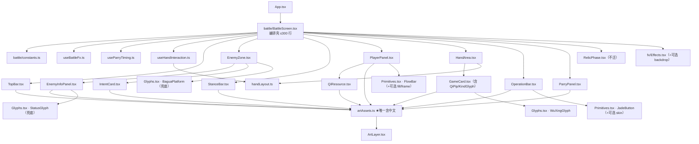

# 战斗界面素材接入 + BattleScreen 拆分 · 架构方案

> 架构师高见远产出 ｜ 目标：把 29 张 `ui_` 界面零件接入代码，同期拆分 2147 行的 `BattleScreen.tsx`
> 目标平台：手机竖屏 390×844 ｜ 技术栈：Vite 8 + React 19 + TS 6 + oxlint + vitest（**零第三方库**）
> 本方案不改引擎、不动 `src/styles/**`、不引入任何依赖。

---

## 一、关键决策

| # | 决策 | 理由 |
|---|---|---|
| **D1** | 接入 = **「基底 CSS 层 + `ArtLayer` 叠加层」双层结构**，不做 `onError` 探测 | 现有约定（`CARD_FACE` 注释）就是「图挂不上就只剩渐变底」。**CSS 的 `background-image`/`border-image` 加载失败不会触发 `onError`**（只有 `` 会），用 `onError` 就得为 29 张图各挂 error 态 + `useState`。双层结构天然「不白屏、不报错、无 FOUC、无布局跳动」 |
| **D2** | 九宫格用**百分比** `border-image-slice`，**禁用像素数字** | 实测生成像素与文档标注严重不符（5×–22× 而非 4×），且抠图会裁包围盒改尺寸 → 百分比与分辨率解耦，重导出不会坏 |
| **D3** | **所有中文素材文件名集中到唯一新文件 `artAssets.ts`**，并为其登记一条 §9 白名单 | §9 只放过中文字面量。素材名（`'ui_血条_框.png'`）含中文 → 出现即 **error** 卡住 `npm run build`。集中到一个文件只需登记**一条**，与既有 `src/game/audio.ts`（「音频资源文件名（非界面文案）」）完全同构 |
| **D4** | 拆分出的新组件文案**一律走 `t()`**，不给新组件登记白名单；同时**下调** `BattleScreen.tsx` 台账计数 | §9 是渐进收紧：新文件不在台账 → 写中文即 error。登记白名单 = 把 S2 债务人为摊到 10+ 个新文件。拆分恰好是「第一次把这些文案集中到单一组件」，此刻抽 `t()` 成本最低 |
| **D5** | 动态填充两型分开处理：**无内刻度 → 9-slice 缩放**（血条/势条）；**有内刻度 → 裁剪揭示 clip-reveal**（炁槽） | 血条图无内部格线，9-slice 让填充块自己长成胶囊（右端帽保形）；炁槽图**烘焙了格线 + 日月标记**，按宽度缩放会压扁格线、与「可分配炁点」对不齐 → 必须固定原尺寸 + `overflow:hidden` 从左侧揭示 |
| **D6** | 执行顺序：**基建先行 → 按分区「拆分 + 接入」合并 → 统一回归**。**禁止先接再拆** | 先接再拆会让素材 diff 与拆分 diff 在同文件互相污染，review 无法区分。而「全局先拆完再接」要多一轮人工回归，但 **UI 层没有任何自动化测试**（102 条测试全在 engine/i18n），纯搬家无法被机器验证 → 多一轮回归换不来机器保障 |
| **D7** | `ui/Primitives.tsx`、`svg/Glyphs.tsx`、`fx/Effects.tsx` **只加「可选 prop」，默认值下行为零变化** | 已核实 `JadeButton`/`GoldPanel` 被 `Screens.tsx`（主界面/编队/结算）复用 —— 把战斗美术硬塞进去会污染外围界面 |
| **D8** | **不新建 CSS 文件、不编辑 `src/styles/**`**，9-slice 走内联样式 + `nineSlice()` helper | 新建 `.css` 既不在 `HEX_EXEMPT` 也不在 CJK 台账 → 任何 hex、代码里任何中文都是 error。现有战斗样式全是内联 |
| **D9** | 状态图集采用**「图集优先 + SVG 兜底」混合渲染** | 图集 6 格 = ①灼烧②霜寒③冻结④破甲⑤虚弱⑥护盾。但 `StatusId` 有 **8** 个成员（多 `paralyze`/`silence`/`flaw`），且第 6 格「护盾」不是 StatusId（护盾是数值字段）⇒ 只有 5 个状态有图，其余必须回落 `StatusGlyph` |
| **D10** | **不做全量 preload**，按渲染时机惰性请求 | 29 张 ≈ **5.1MB**。基底 CSS 始终可见，图到达时是"补花纹"而非"补内容"，不需要 preload 防白屏 |

---

## 二、文件列表

### 2.1 新增（全部位于 `src/components/battle/`）

| 文件 | 职责 | 预估行数 | 来源（现今 `BattleScreen.tsx` 行号） |
|---|---|---|---|
| `battle/constants.ts` | 常量搬迁 + `BASE` | ~40 | `42-63` |
| `battle/artAssets.ts` | ★**唯一含中文字面量的新文件**：`UI` 素材名表、`artUrl()`、`SLICE`、`nineSlice()`、`statusAtlasStyle()`、`WUXING_SEAL`、`CARD_FACE`、`faceKeyOf()` | ~130 | 新增 + 搬运 `1827-1843` |
| `battle/ArtLayer.tsx` | 通用素材叠加层（`slice`/`fit` 两模式）—— 降级机制载体 | ~70 | 新增 |
| `battle/handLayout.ts` | 纯函数：手牌 `step`/`overlap`/`rot`/`arc`/`z` | ~50 | 抽自 `969-999` |
| `battle/useHandInteraction.ts` | 选中/融合/拖拽 + 3 个 pointer handler | ~170 | 抽自 `203-337` |
| `battle/useBattleFx.ts` | `hitstop`/`shake`/`hurt`/`lotus`/`relicFlows`/`relicGhosts` + 特效消费 | ~180 | 抽自 `86-158` |
| `battle/useParryTiming.ts` | 前摇计时 + `handleParry` | ~70 | 抽自 `172-201` |
| `battle/TopBar.tsx` | ①天时条（月令/炁候/回合/撤退） | ~110 | 抽自 `422-503` |
| `battle/StanceBar.tsx` | ④架势条 + 预选 + 确认 | ~130 | 抽自 `640-758` |
| `battle/PlayerPanel.tsx` | ⑤我方面板 | ~170 | 抽自 `760-930` |
| `battle/QiResource.tsx` | 阴阳炁条 | ~60 | 搬运 `1662-1712` |
| `battle/EnemyZone.tsx` | ③敌方区容器 | ~90 | 抽自 `505-638` |
| `battle/EnemyInfoPanel.tsx` | 敌人信息板 | ~160 | 搬运 `1524-1660` |
| `battle/IntentCard.tsx` | 敌方意图卡 | ~120 | 搬运 `1714-1818` |
| `battle/HandArea.tsx` | ⑥手牌区 + 教学提示 + 空手牌槽 | ~170 | 抽自 `932-1098` |
| `battle/GameCard.tsx` | 卡牌（含 `QiPip` + `KindGlyph`） | ~320 | 搬运 `1820-2147` |
| `battle/OperationBar.tsx` | ⑦操作栏 + 战报 | ~180 | 抽自 `1227-1382` |
| `battle/ParryPanel.tsx` | ⑨弹反面板 | ~150 | 抽自 `1099-1224` |

> `QiPip`(2109)/`KindGlyph`(2129) 归入 `GameCard.tsx`；`faceKeyOf`(1839)/`CARD_FACE`(1827) 归入 `artAssets.ts`。

### 2.2 修改

| 文件 | 改动 | 风险 |
|---|---|---|
| `src/components/BattleScreen.tsx` | 重写为编排壳（仅保留 Props、`char/month/term` 派生、`aliveEnemies/targetId`、`intentOf`、`regulate` 派生，组合 7 分区 + 3 hook），**目标 ≤ 300 行** | 中（行为零变化） |
| `src/components/ui/Primitives.tsx` | `JadeButton` + 可选 `skin?`；`FlowBar` + 可选 `fill?/frame?`。默认 `undefined` → 与 `Screens.tsx` 现状完全一致 | 低（**禁止**写 hex/中文） |
| `src/components/fx/Effects.tsx` | `DamageNumberLayer` + 可选 `backdrop?`。默认 `undefined` → 不变 | 低（该文件在豁免名单内，**新增代码不得加 hex、不得加中文**） |
| `src/i18n/locales/zh-CN.ts` | 新增 `ui.battle.*` / `tip.battle.*` 文案域 | 低 |
| `scripts/架构守卫.mjs` | ①`CJK_PENDING['BattleScreen.tsx']` 计数下调（归零则删条）②**新增** `artAssets.ts` 台账条目（理由：「素材文件名（中文）—— 非界面文案，与 `src/game/audio.ts` 同构」） | 低 |

---

## 三、29 张素材接入对照表

> 「现有实现位置」= **当前**（未拆分）行号。接入方式缩写：**9S**=`border-image` 九宫格；**BG**=定尺寸 `background-image`；**CLIP**=裁剪揭示；**OV**=叠加层

### 3.1 顶部（2）

| 素材 | 显示(实测生成) | 可拉伸 | 现有实现位置 | 落点 | 方式 | 降级回退 |
|---|---|---|---|---|---|---|
| `ui_天时条.png` | 390×36 (2032×398) | ✅ | `BattleScreen.tsx:423-436`（gradient @431、`borderBottom:1.5px solid var(--color-miaojin)` @432、`boxShadow` @435） | `TopBar.tsx` | **9S** `OV` | 保留现 gradient+borderBottom+boxShadow |
| `ui_回合计数牌.png` | 44×22 (927×720) | ❌ | `BattleScreen.tsx:468-482` | `TopBar.tsx` | **BG** 44×22（文字底板，z 低于文字） | 纯文字（现状） |

### 3.2 敌方区（14）

| 素材 | 显示(实测) | 可拉伸 | 现有实现位置 | 落点 | 方式 | 降级回退 |
|---|---|---|---|---|---|---|
| `ui_敌方底台.png` | 300×116 (1464×720) | ❌ | `Glyphs.tsx:124-183` `BaguaPlatform`，调用 `BattleScreen.tsx:583` | `EnemyZone.tsx` | **BG** 定尺寸，叠在 `BaguaPlatform` **之下** | 现 `BaguaPlatform` SVG |
| `ui_意图卡底.png` | 96×48 (1649×594) | ✅ | `BattleScreen.tsx:1752-1771`（bg @1762-1765、border @1766、radius:5 @1757） | `IntentCard.tsx` | **9S** | 现宣纸渐变 + miaojin 边 |
| `ui_血条_框.png` | 96×10 (2118×242) | ✅ | `BattleScreen.tsx:1592-1600` | `EnemyInfoPanel.tsx` | **9S** `OV`（中空框叠最上） | 现 rgba 底 + 金边 + 圆角 |
| `ui_血条_红.png` | 96×10 (2091×198) | ✅ | `BattleScreen.tsx:1602-1610`（`transition:width 260ms` @1607） | `EnemyInfoPanel.tsx` | **9S** 于填充 div（`width:eHpPct%`） | 现红渐变 + `boxShadow` |
| `ui_血条_绿.png` | 96×10 (2091×196) | ✅ | `BattleScreen.tsx:1611-1622` | `EnemyInfoPanel.tsx` | **9S**（同红条，`left:eHpPct%` 起） | 现松花绿渐变 + `borderLeft` 亮边 |
| `ui_势条_填充.png` | 96×6 (2108×137) | ✅ | `BattleScreen.tsx:1802-1814`（`shiCap` 个 5×3 pip） | `IntentCard.tsx` | **9S** 于填充 div（`width:shi/shiCap%`） | 现 CSS pip 排 |
| `ui_势条_格.png` | 96×6 (2074×112) | ✅ | 同上 `1802-1814` | `IntentCard.tsx` | **BG** `100% 100%` `OV`（透明底刻线遮罩） | 现 CSS pip 排 |
| `ui_五行印_金/木/水/火/土.png` | 15×15 (≈748×720) | ❌ | `Glyphs.tsx:97-118` `WuXingSeal`，调用 `BattleScreen.tsx:2009` | `GameCard.tsx` | **BG** 15×15（**替换** `WuXingSeal`） | 现 `WuXingSeal`（色块+汉字） |
| `ui_破绽标记.png` | 28×28 (733×720) | ❌ | `BattleScreen.tsx:613-630`（「破绽」文字角标） | `EnemyZone.tsx` | **BG** 28×28 定位于立绘盒 | 现「破绽」文字角标 |
| `ui_状态图标.png` | 格 16×16 (2055×318，6 格) | ❌ | `Glyphs.tsx:189-261` `StatusGlyph`，调用 `BattleScreen.tsx:1651` | `EnemyInfoPanel.tsx` | **图集精灵**（见 §四.3） | `StatusGlyph` SVG（**逐状态**兜底） |

### 3.3 中段 · 架势/我方（5）

| 素材 | 显示(实测) | 可拉伸 | 现有实现位置 | 落点 | 方式 | 降级回退 |
|---|---|---|---|---|---|---|
| `ui_架势条_底.png` | 330×38 (1966×275) | ✅ | `BattleScreen.tsx:641-651`（容器**无底图**） | `StanceBar.tsx` | **9S** `OV` 作轨道 | **透明**（现容器本无背景） |
| `ui_架势条_亮.png` | 110×34 (1862×335) | ❌ | `BattleScreen.tsx:686-690`（active 朱红 gradient） | `StanceBar.tsx` | **BG** 110×34 于 active 格 `OV` | 现三态 gradient（active/pending/idle） |
| `ui_我方面板.png` | 370×104 (1996×647) | ✅ | `BattleScreen.tsx:761-776`（gradient @771、border @772、radius:8 @770、shadow @773） | `PlayerPanel.tsx` | **9S** `OV`（头像凹槽需与 `<CharacterFigure size={84}>` 对齐） | 现 gradient + border + shadow |
| `ui_炁槽_阳.png` | 120×16 (2086×382) | ❌ | `BattleScreen.tsx:1693-1708` | `QiResource.tsx` | **CLIP**（固定 120px） | 现分段 flex pip（`Math.min(cap,14)` 段） |
| `ui_炁槽_阴.png` | 120×16 (2097×386) | ❌ | 同上 | `QiResource.tsx` | **CLIP** | 同上 |

### 3.4 操作区（8）

| 素材 | 显示(实测) | 可拉伸 | 现有实现位置 | 落点 | 方式 | 降级回退 |
|---|---|---|---|---|---|---|
| `ui_玉按钮_主.png` | ≈170×40 (1950×388) | ✅ | `Primitives.tsx:99-105`，调用 `BattleScreen.tsx:1252-1264`(出牌)、`1338-1346`(结束回合) | `OperationBar.tsx`+`Primitives` 可选 prop | **9S** `OV` | 现朱红 gradient |
| `ui_玉按钮_金.png` | ≈170×40 (1963×397) | ✅ | `Primitives.tsx:99-105`，调用 `BattleScreen.tsx:1274-1295`(合并奥义) | 同上 | **9S** `OV` | 现描金 gradient |
| `ui_玉按钮_灰.png` | ≈170×40 (1937×352) | ✅ | `Primitives.tsx:100/105`，调用 `BattleScreen.tsx:1315-1331` | 同上 | **9S** `OV`（覆盖 ghost + disabled 两态） | 现 ghost/disabled |
| `ui_战报框.png` | 370×82 (1906×516) | ✅ | `BattleScreen.tsx:1356-1380`（bg @1363、border @1364、`borderLeft:3px` @1365） | `OperationBar.tsx` | **9S** `OV`（左切片加大） | 现深底 + 金边 + 左粗边 |
| `ui_弹反区_金.png` | ≈60×90 (390×720) | ✅(横向) | `BattleScreen.tsx:1138-1150`（`left:(TELEGRAPH/TOTAL)*100%` @1141） | `ParryPanel.tsx` | **9S** 横向（上下切片 0） | 现 rgba 金渐变 |
| `ui_弹反区_红.png` | ≈130×90 (453×720) | ✅(横向) | `BattleScreen.tsx:1128-1137`（`width:(TELEGRAPH/TOTAL)*100%` @1132） | `ParryPanel.tsx` | **9S** 横向 | 现 rgba 朱红 |
| `ui_伤害飘字底.png` | 64×36 (1560×720) | ❌ | `Effects.tsx:198-233`（数字 `<div>`，无底板） | `Effects.tsx` 可选 prop + `App.tsx:130` | **BG** 64×36 作数字底板 | **无**（数字自带 `textShadow` @221，底板纯装饰） |
| `ui_空手牌槽.png` | 78×112 (504×720) | ❌ | `BattleScreen.tsx:1036-1047`（「手牌已空」文字） | `HandArea.tsx` | **BG** 78×112（文字压其上） | 现「手牌已空」文字 |

> **`ui_空手牌槽` 是唯一「新增视觉」而非替换**：现设计手牌为空只显示文字，本方案在其后加**一枚**虚线空槽底板。

---

## 四、统一降级机制（实现骨架）

### 4.1 层次铁律

```
┌─ 叠加层 ArtLayer / 图像层 ── background-color 必须 transparent；绝不设不透明底色
├─ 内容层（文字/数字/立绘）
└─ 基底 CSS 层 ────── 渐变 / border / boxShadow / borderRadius（图缺失时唯一可见的东西）
```

三层必须是**兄弟节点**，不能用「同一元素的 `background-color` + `background-image`」代替（一旦当叠加层放到底层之上，不透明底会盖死底层）。

### 4.2 `artAssets.ts` 骨架

```ts
/**
 * 【本文件是全项目「除 src/i18n/** 外」唯一含中文字面量的新文件】
 * 这里的中文是**素材文件名（数据）**，不是界面文案 —— 与 src/game/audio.ts 同构，
 * 已在 scripts/架构守卫.mjs 的 CJK_PENDING 登记白名单。
 * ⚠ 本文件不得新增任何「玩家可见的中文文案」（那必须走 t()）。
 */
import type { CSSProperties } from 'react';
import type { Card, StatusId, WuXing } from '../../game/types';

export function artUrl(fileName: string): string {
  return `${import.meta.env.BASE_URL}art/${fileName}`;
}

export const UI = {
  topBar: 'ui_天时条.png',
  turnPlaque: 'ui_回合计数牌.png',
  enemyPlatform: 'ui_敌方底台.png',
  intentCardBg: 'ui_意图卡底.png',
  hpFrame: 'ui_血条_框.png',
  hpFill: 'ui_血条_红.png',
  shieldFill: 'ui_血条_绿.png',
  shiFill: 'ui_势条_填充.png',
  shiTicks: 'ui_势条_格.png',
  flawMark: 'ui_破绽标记.png',
  statusAtlas: 'ui_状态图标.png',
  stanceBase: 'ui_架势条_底.png',
  stanceGlow: 'ui_架势条_亮.png',
  playerPanel: 'ui_我方面板.png',
  qiYang: 'ui_炁槽_阳.png',
  qiYin: 'ui_炁槽_阴.png',
  btnPrimary: 'ui_玉按钮_主.png',
  btnGold: 'ui_玉按钮_金.png',
  btnGhost: 'ui_玉按钮_灰.png',
  logFrame: 'ui_战报框.png',
  parryGold: 'ui_弹反区_金.png',
  parryRed: 'ui_弹反区_红.png',
  dmgBackdrop: 'ui_伤害飘字底.png',
  emptySlot: 'ui_空手牌槽.png',
} as const;

export const WUXING_SEAL: Record<WuXing, string> = {
  jin: 'ui_五行印_金.png',
  mu: 'ui_五行印_木.png',
  shui: 'ui_五行印_水.png',
  huo: 'ui_五行印_火.png',
  tu: 'ui_五行印_土.png',
};

/** 卡面分型映射（自 BattleScreen.tsx:1827-1843 搬运，行为不变） */
export const CARD_FACE: Record<string, string> = {
  ultimate: 'card_奥义.png',
  physical: 'card_物理.png',
  support: 'card_功能.png',
  'spell-jin': 'card_术法_金.png',
  'spell-mu': 'card_术法_木.png',
  'spell-shui': 'card_术法_水.png',
  'spell-huo': 'card_术法_火.png',
  'spell-tu': 'card_术法_土.png',
};

export function faceKeyOf(card: Card): string {
  if (card.isUltimate) return 'ultimate';
  if (card.kind === 'spell' && card.wuxing) return `spell-${card.wuxing}`;
  return card.kind;
}

/**
 * 九宫格切片表。**一律用百分比**（生成像素与文档标注不符，且抠图会改尺寸 → 百分比才与分辨率解耦）。
 * slice 顺序 = 上 右 下 左；width = 渲染端头厚度（px，可独立于 slice）。
 * 首轮取值由「按实测图目测端饰占比」得出，实现时可微调 —— **但不得改成像素数字**。
 */
export const SLICE = {
  topBar:      { slice: '26% 5% 26% 5%',   width: '0 10px 0 10px' },
  intentCard:  { slice: '16% 10% 16% 10%', width: '6px 8px 6px 8px' },
  stripCaps:   { slice: '0 8% 0 8%',       width: '0 8px 0 8px' },
  shiFill:     { slice: '0 10% 0 10%',     width: '0 6px 0 6px' },
  stanceBase:  { slice: '20% 5% 20% 5%',   width: '0 8px 0 8px' },
  playerPanel: { slice: '18% 12% 18% 12%', width: '12px 14px 12px 14px' },
  jadeButton:  { slice: '24% 9% 24% 9%',   width: '8px 10px 8px 10px' },
  logFrame:    { slice: '14% 6% 14% 14%',  width: '8px 8px 8px 14px' },
  parryZone:   { slice: '0 8% 0 8%',       width: '0 10px 0 10px' },
} as const;

/** 九宫格 → 内联样式（`border-image` 会忽略 `border-radius`，形状由素材提供） */
export function nineSlice(fileName: string, s: { slice: string; width: string }): CSSProperties {
  return {
    borderStyle: 'solid',
    borderWidth: s.width,
    borderColor: 'transparent',
    borderImageSource: `url(${artUrl(fileName)})`,
    borderImageSlice: s.slice,
    borderImageWidth: s.width,
    borderImageRepeat: 'stretch',   // 中间段拉伸；勿用 repeat/round（描金边会重复）
  };
}

/* ---------------------------- 状态图集精灵 ---------------------------- */
/**
 * ui_状态图标.png = 横排 6 格：①灼烧 ②霜寒 ③冻结 ④破甲 ⑤虚弱 ⑥护盾
 * 【只有 5 个 StatusId 有图】paralyze / silence / flaw 无对应格 → 返回 null，
 * 调用方回落现有 SVG `StatusGlyph`。
 * 第 6 格「护盾」不是 StatusId（护盾是数值字段），本表**不登记**。
 */
const ATLAS_COLS = 6;
const ATLAS_CELL: Partial<Record<StatusId, number>> = {
  burn: 0, frost: 1, freeze: 2, armorBreak: 3, weak: 4,
};

export function statusAtlasStyle(id: StatusId, size: number): CSSProperties | null {
  const cell = ATLAS_CELL[id];
  if (cell === undefined) return null;
  return {
    display: 'inline-block',
    width: size,
    height: size,
    backgroundImage: `url(${artUrl(UI.statusAtlas)})`,
    backgroundRepeat: 'no-repeat',
    backgroundSize: `${ATLAS_COLS * 100}% 100%`,
    backgroundPositionX: `${(cell / (ATLAS_COLS - 1)) * 100}%`,
  };
}
```

### 4.3 `ArtLayer.tsx` 骨架

```tsx
import type { CSSProperties } from 'react';
import { artUrl, nineSlice } from './artAssets';

interface ArtLayerProps {
  fileName: string;
  /** 'slice' = 九宫格拉伸（面板/条/按钮）；'fit' = 原尺寸（印章/图标/占位槽） */
  mode: 'slice' | 'fit';
  slice?: { slice: string; width: string };
  fit?: { w: number; h: number };
  style?: CSSProperties;
  zIndex?: number;
}

/**
 * 素材叠加层 —— **降级铁律的载体**。
 *
 * 调用方**必须先画好基底 CSS 层**（渐变 + 描金边 + 圆角），本组件只在其上再贴一层图。
 * 图缺失 / 404 / 尚未生成时，本层渲染为空 → 基底原样可见：
 *   不白屏、不报错、无 FOUC、无布局跳动。
 *
 * 【为什么不用 onError】CSS 的 background-image / border-image 加载失败**不会**触发
 * onError（只有  会）。用  就要为 29 张图各挂 error 态 + useState，徒增状态与竞态。
 */
export function ArtLayer({ fileName, mode, slice, fit, style, zIndex = 1 }: ArtLayerProps) {
  const base: CSSProperties = {
    position: 'absolute',
    inset: 0,
    pointerEvents: 'none',
    backgroundColor: 'transparent', // ★ 铁律：图像层绝不设不透明底色
    zIndex,
    ...style,
  };
  if (mode === 'slice') {
    return <div aria-hidden style={{ ...base, ...nineSlice(fileName, slice!) }} />;
  }
  return (
    <div
      aria-hidden
      style={{
        ...base,
        inset: 'auto',
        width: fit?.w,
        height: fit?.h,
        backgroundImage: `url(${artUrl(fileName)})`,
        backgroundRepeat: 'no-repeat',
        backgroundSize: '100% 100%',
      }}
    />
  );
}
```

### 4.4 动态填充两型落地

**(a) 血条（9-slice 缩放）** — 替换 `BattleScreen.tsx:1591-1623`：

```tsx
<div style={{ position: 'relative', width: 96, height: 10 }}>
  {/* 基底：图缺失时可见 */}
  <div style={{ position: 'absolute', inset: 0, background: 'rgba(0,0,0,0.45)', borderRadius: 5 }} />
  {/* 血量填充 */}
  <div style={{ position: 'absolute', left: 0, top: 0, height: '100%', width: `${eHpPct}%`,
                transition: 'width 260ms', ...nineSlice(UI.hpFill, SLICE.stripCaps) }} />
  {/* 护盾填充 */}
  {eShield > 0 && (
    <div style={{ position: 'absolute', left: `${eHpPct}%`, top: 0, height: '100%',
                  width: `${eShPct}%`, transition: 'width 260ms',
                  ...nineSlice(UI.shieldFill, SLICE.stripCaps) }} />
  )}
  {/* 中空外框：叠最上 */}
  <ArtLayer fileName={UI.hpFrame} mode="slice" slice={SLICE.stripCaps} zIndex={2} />
</div>
```

**(b) 炁槽（clip-reveal）** — 替换 `BattleScreen.tsx:1693-1708`：

```tsx
/** 图里烘焙了格线 + 日月标记，按宽度缩放会压扁格线 → 固定 120px，从左侧揭示 */
function QiTrack({ file, value, cap }: { file: string; value: number; cap: number }) {
  const pct = cap > 0 ? Math.max(0, Math.min(100, (value / cap) * 100)) : 0;
  return (
    <div style={{ position: 'relative', width: 120, height: 16, flex: '0 0 auto' }}>
      <div style={{ position: 'absolute', inset: 0, opacity: 0.26,
                    backgroundImage: `url(${artUrl(file)})`, backgroundSize: '100% 100%' }} />
      <div style={{ position: 'absolute', left: 0, top: 0, bottom: 0, width: `${pct}%`, overflow: 'hidden' }}>
        <div style={{ width: 120, height: 16,
                      backgroundImage: `url(${artUrl(file)})`, backgroundSize: '100% 100%' }} />
      </div>
    </div>
  );
}
```

### 4.5 性能约定

| 措施 | 做法 |
|---|---|
| 不预载 | 双层结构保证「图到即贴」 |
| 惰性请求 | CSS `background-image` 只在元素进入布局时请求 ⇒ **条件渲染**即可自动惰性化：`弹反区_金/红` 仅 `phase==='enemyTelegraph'`；`空手牌槽` 仅 `hand.length===0`；`五行印` 仅该五行存在；`damageBackdrop` 仅 `pendingNumbers` 非空 |
| 条件渲染必须是 DOM 增删 | 不要用 `visibility/opacity` 隐藏（那样仍会请求图） |
| 不做雪碧图合并 | 27+ 张分散请求在 HTTP/2 下开销可接受，合并反而破坏「按状态惰性加载」 |

---

## 五、拆分后结构

### 5.1 主组件 1452 行里混了什么

| 类别 | 行号 | 去向 |
|---|---|---|
| 常量/配置 | `42-63` | → `battle/constants.ts` |
| 状态派生（血条%、能否出牌、架势选择、意图取值、调息单一真源） | `73-74,129-130,352-372,874-929` | 派生留在 `BattleScreen.tsx`（跨分区共享）；**纯计算**（手牌布局数学）→ `battle/handLayout.ts` |
| 交互逻辑（pointer 拖拽、弹反计时、特效消费） | `103-337` | → 3 个 Hook |
| 大段 JSX 布局 | `374-1519` | → 7 个分区子组件 |

### 5.2 模块依赖图



---

## 六、任务列表（9 条 · 有序 · 含依赖与验收）

### T01 · i18n 词表扩张（战斗界面全量文案）`P0`
- **文件**：`src/i18n/locales/zh-CN.ts`
- **依赖**：无
- **做**：把 `BattleScreen.tsx`（及将迁出的全部子组件）里**所有玩家可见中文**抽为键，建两个新域：
  - `ui.battle.*`：短文案（`end-turn`=「结 束 回 合」、`play-card`、`fold`、`hand-empty`、`retreat`、`stance-confirm`、`parry-button`、`card-unfusable`（带 `{a}{b}` 参数）等）
  - `tip.battle.*`：全部 `Tip` 长释义（含 `\n`，**逐字搬运**，插值改 `{name}` 形式）
  - 命名规范：小写 ASCII / `.` 分层 / 多词用 `-` / **禁止拼音** / 占位名小驼峰
- **验收**：`npx tsc -b` 通过；`npx vitest run` 102 全绿（含 `i18n.test.ts` 孤儿键扫描）；`npm run guard` 无新 error
- **风险**：`\n` 与 `{…}` 必须逐字搬运，**禁止顺手改文案**

### T02 · battle/ 基建 `P0`
- **文件**：新增 `battle/constants.ts`、`handLayout.ts`、`artAssets.ts`、`ArtLayer.tsx`；改 `BattleScreen.tsx`（改 import）、`scripts/架构守卫.mjs`（台账）
- **依赖**：无
- **做**：① 常量**逐个原值**搬走，`BattleScreen` 改 import；② `handLayout.ts` 抽出手牌布局数学（自 `969-999`），**数值与结构逐字保留**；③ 按 §4.2 建 `artAssets.ts`（**只建立、不引用**，保证本任务视觉零变化）；④ 按 §4.3 建 `ArtLayer.tsx`；⑤ 守卫台账登记 `artAssets.ts`
- **验收**：四连绿（`tsc`/`vitest` 102/`oxlint`/`guard`）+ **界面像素级无变化**

### T03 · 拆分①：顶部 + 架势区（拆分+接入合并）`P0`
- **文件**：新增 `battle/TopBar.tsx`、`battle/StanceBar.tsx`；改 `BattleScreen.tsx`
- **依赖**：T01、T02
- **做**：搬 `422-503`→`TopBar`、`640-758`→`StanceBar`；接 **`ui_天时条`(9S)/`ui_回合计数牌`(BG)/`ui_架势条_底`(9S)/`ui_架势条_亮`(BG)**；架势三态 + 确认键脉冲动画**逐字保留**
- **验收**：天时条文字仍清晰；三格架势分隔线与素材两道描金竖线**对齐**（错位则调 `SLICE.stanceBase` 或加 padding）；`t()` 无中文残留；四连绿

### T04 · 拆分②：我方区 `P0`
- **文件**：新增 `battle/PlayerPanel.tsx`、`battle/QiResource.tsx`；改 `BattleScreen.tsx`、`ui/Primitives.tsx`（`FlowBar` 加可选 `fill?/frame?`）
- **依赖**：T01、T02
- **做**：搬 `760-930`→`PlayerPanel`、`1662-1712`→`QiResource`；接 **`ui_我方面板`(9S，头像凹槽需与 `<CharacterFigure size={84}>` 对齐)/`ui_炁槽_阳`+`阴`(CLIP)**；气血条经 `FlowBar` 接 **`ui_血条_框`+`红`+`绿`**（护盾压缩刻度 `denom=cap+shield` **不得改**）
- **验收**：护盾出现时血条肉眼可见变短（既有语义保留）；`Screens.tsx` 的组件外观**零变化**；四连绿

### T05 · 拆分③：敌方区 `P0`
- **文件**：新增 `battle/EnemyZone.tsx`、`EnemyInfoPanel.tsx`、`IntentCard.tsx`；改 `BattleScreen.tsx`
- **依赖**：T01、T02
- **做**：搬 `505-638`→`EnemyZone`、`1524-1660`→`EnemyInfoPanel`、`1714-1818`→`IntentCard`；接 **`ui_敌方底台`(BG，叠在 `BaguaPlatform` 之下)/`ui_意图卡底`(9S)/`ui_血条_框`+`红`+`绿`(9S)/`ui_势条_填充`(9S)/`ui_势条_格`(BG)/`ui_破绽标记`(BG，替换「破绽」文字角标)/`ui_状态图标`(图集 + `StatusGlyph` 兜底)**；`colW/isBoss?126:112`、`figH/isBoss?112:90`、`BaguaPlatform size/isBoss?112:94`、`EnemyFigure size={figH/1.35}`、径向压边 `flawPulse` **逐字保留**
- **验收**：三列意图卡横向对齐；`paralyze`/`silence`/`flaw` 显示为 SVG（兜底生效）；四连绿

### T06 · 拆分④：手牌区 `P0`
- **文件**：新增 `battle/HandArea.tsx`、`GameCard.tsx`、`useHandInteraction.ts`；改 `BattleScreen.tsx`
- **依赖**：T01、T02
- **做**：搬 `1853-2147`→`GameCard`（含 `QiPip`/`KindGlyph`）；搬 `932-1098`→`HandArea`；抽 `203-337`→`useHandInteraction`；接 **`ui_五行印_*`(BG 15×15，替换 `WuXingSeal` 的汉字色块)**
- **验收（本任务最敏感）**：① 轻点已选中的牌去合体仍走**合体**分支（`MOVE_SLOP_PX=12` 手感不变）；② 收拢态每张牌**恰好只露左侧一条边**（`FOLD_STEP=32`）且左金条可见；③ 展开态 `step=max(20,min(84,even))`、`even=floor((344-78)/(n-1))`、`overlap=max(0,78-step)`、`rot`/`arc`/上浮 `-58px/scale1.12`/partner `-22px/scale1.06`/`z=300·200+i·400`、`transition 190ms cubic-bezier(0.2,0.9,0.3,1.05)`、`paddingTop34/paddingBottom8` **全部逐字保留**；④ 四连绿

### T07 · 拆分⑤：操作栏 + 战报 `P0`
- **文件**：新增 `battle/OperationBar.tsx`；改 `BattleScreen.tsx`、`ui/Primitives.tsx`（`JadeButton` 加可选 `skin?`）
- **依赖**：T01、T02、T04（同改 `Primitives.tsx`，串行避免冲突）
- **做**：搬 `1227-1382`→`OperationBar`；接 **`ui_玉按钮_主/金/灰`(9S)/`ui_战报框`(9S，左切片加大)**；`ctaPulse`/`fuseHint`/调息单一真源（`regulateOutcome`）**不得改**
- **验收**：四按钮禁用态（`opacity .45/.7`）与灰按钮叠加后仍能表达「不可用」；战报 `height:82`、`slice(-40).reverse().slice(0,12)`、`opacity:1-i*0.05` 不变；`Screens.tsx` 外观零变化；四连绿

### T08 · 拆分⑥：弹反面板 + 特效钩子 `P0`
- **文件**：新增 `battle/ParryPanel.tsx`、`useParryTiming.ts`、`useBattleFx.ts`；改 `BattleScreen.tsx`、`fx/Effects.tsx`（`DamageNumberLayer` 加可选 `backdrop?`）
- **依赖**：T01、T02
- **做**：搬 `1099-1224`→`ParryPanel`；抽 `172-201`→`useParryTiming`、`86-158`→`useBattleFx`；接 **`ui_弹反区_红/金`(9S 横向)/`ui_伤害飘字底`(BG 64×36)**；`parry-cursor` 动画、`PARRY_TELEGRAPH_MS/PARRY_TOTAL_MS` 分段百分比、格挡按钮 `334×104/fontSize30/letterSpacing10` **逐字保留**；`hitstop` 850ms、`warn` 1600ms、`lotus` 1600ms、流光清理 `RELIC_FLOW_MS+1700` **不变**
- **验收**：完美弹反窗口读写（`inWindow`/`telegraphStartRef`/`actDispatched`）与 `dispatch(ENEMY_ACT/PARRY)` 时序**零变化**；`Effects.tsx` 新代码**无 hex、无中文**；四连绿

### T09 · 收尾：空手牌槽 + 降级回归 + 台账更新 + 全量验证 `P0`
- **文件**：改 `battle/HandArea.tsx`、`scripts/架构守卫.mjs`、必要时 `BattleScreen.tsx`
- **依赖**：T03–T08
- **做**：① 接 **`ui_空手牌槽`(BG 78×112)**，文字压其上；② **降级回归**（临时改名 `public/art/ui_*.png` 或 DevTools 屏蔽，确认每张图缺失都回落现 CSS 外观、不白屏不报错）；③ 台账：`BattleScreen.tsx` 计数下调（归零则删条），核对 `artAssets.ts` 计数；④ 全量验证四连
- **验收**：四连绿（**0 error**；⚠ 不增长）；`BattleScreen.tsx` 最终 **≤ 300 行**

#### 手工回归清单（UI 层无自动化测试，必须逐条走）
1. 4 场战役可连续打完；
2. 手牌收拢态每张只露左边一条、左金条可见；
3. 轻点/上拖选中；再点/下拖取消；点红框牌**即刻合体**成奥义；
4. 敌方前摇 → 游标划过 → 完美弹反**免疫 + 追击**、早按**减伤60%**、不按**全额承伤**；
5. 归墟流光飞向底部炁条（`QI_BAR_TARGET=(292,386)` 命中）、一次弃 ≥3 张绽放莲花；
6. 护盾出现时血条变短、右侧松花绿一段；
7. 架势点选只预选、按「确认」才切换；本回合已切换则按钮禁用；
8. 结算/主界面/编队外观**零变化**。

> **依赖图**：`T01 ∥ T02` → `T03…T08`（可并行，唯 T04→T07 串行同文件）→ `T09`

---

## 七、必须保值的魔法数字清单

### 7.1 具名常量（`BattleScreen.tsx:42-63` → `battle/constants.ts`）

| 常量 | 值 | 语义 |
|---|---|---|
| `QI_BAR_TARGET` | `{ x: 292, y: 386 }` | 归墟流光终点 |
| `RELIC_FLOW_MS` | `700` | **必须与 `global.css` 的 `relicFlow` 时长一致** |
| `INTENT_H` | `48` | 敌方区三段定高 |
| `FIGBOX_H` | `116` | 立绘盒定高 |
| `INFO_H` | `66` | 信息板定高 |
| `CARD_W` / `CARD_H` | `78` / `112` | 手牌尺寸（5:7） |
| `FOLD_STEP` | `32` | 收拢态每张露出宽度 |
| `SELECT_LIFT_PX` | `46` | 上拖 > 此值 → 选中 |
| `RELEASE_BACK_PX` | `30` | 下拖 > 此值 → 取消选中 |
| `MOVE_SLOP_PX` | `12` | > 此值才算拖动（曾 4px 导致合体分支走不到） |

### 7.2 内联魔法数字（逐字保留，**不得顺手整理**）

天时条高 `36`；敌方区高 `238`；`colW=isBoss?126:112`；`figH=isBoss?112:90`；`BaguaPlatform size=isBoss?112:94`；`EnemyFigure size=figH/1.35`；架势条高 `38`；我方面板高 `104`；手牌 `even=Math.floor((344-CARD_W)/Math.max(1,n-1))`；展开 `step=Math.max(20,Math.min(CARD_W+6,even))`；收拢 `step=Math.max(16,Math.min(FOLD_STEP,even))`；`overlap=Math.max(0,CARD_W-step)`；`rotMax=handExpanded?7:5`；`rot=n<=1?0:((i-mid)/Math.max(1,mid))*rotMax`；`arc=handExpanded?Math.abs(i-mid)*3:Math.abs(i-mid)*1.2`；选中 `'rotate(0deg) translateY(-58px) scale(1.12)'` `z=300`；可合体 `` `rotate(${rot}deg) translateY(-22px) scale(1.06)` `` `z=200+i`；拖动 `z=400`；transition `190ms cubic-bezier(0.2,0.9,0.3,1.05)`；手牌 padding `top34/bottom8`；未参与组合 `opacity 0.45`；不可出牌 `opacity 0.55`；敌人血条 `96×10`；信息板行高 名`16`/值`14`；意图卡净高 `INTENT_H-8=40`；势 pip `5×3`；弹反判定条 `334×26/radius13`；分段 `(PARRY_TELEGRAPH_MS/PARRY_TOTAL_MS)*100%`；格挡按钮 `334×104/fontSize30/letterSpacing10/radius10`；战报 `height:82`、`slice(-40).reverse().slice(0,12)`、`opacity:1-i*0.05`；`hitstop` 850ms；`warn` 1600ms；`lotus` 1600ms；流光清理 `RELIC_FLOW_MS+1700`；`QiResource` 段数 `Math.min(cap,14)`；敌方意图 `intents[(turn-1)%intents.length]`（**必须与引擎 `enemyAct` 一致**）；调息方向 `from = yang>=yin?'yang':'yin'`（并列扣阳）

---

## 八、共享知识（跨文件约定）

| 对象 | 规则 |
|---|---|
| 新增目录 | `src/components/battle/`（**仅**战斗屏；`ui/` 只放无业务语义原子件，`svg/` 只放程序化 SVG） |
| 组件文件 | `PascalCase.tsx`；Hook `useXxx.ts`；非组件模块 `camelCase.ts` |
| 导出 | **具名导出**（无 `default`），与现有一致 |
| 常量 | `battle/constants.ts` 内 `UPPER_SNAKE`；**魔法数字一律先问"能不能进 constants"** |
| 素材路径 | **只允许** `artAssets.ts` 的 `artUrl()` 拼路径；其他文件**禁止**再写 `url(${BASE}art/...)` 或裸中文文件名 |
| 九宫格 | **一律百分比** `slice`，**禁止像素**；`borderImageRepeat:'stretch'`（禁止 `repeat`/`round`）；切片集中在 `SLICE` 表；`border-image` 会忽略 `border-radius` |
| 颜色 | **不新增颜色 token**；新增 CSS 只用 `var(--color-*)` 或 `rgba()`；**不新建 CSS 文件、不改 `src/styles/**`**；图像叠加层 `background-color: transparent` |
| i18n | 界面文案（含 `Tip` 长文、`aria-label`）**必须走 `t()`**；素材文件名集中在 `artAssets.ts` 并登记 `CJK_PENDING`；注释中文**不计入** §9 |
| 降级契约 | **每个使用素材的组件都必须：先在 DOM 里画好"没有素材时的样子"，再用 `ArtLayer`/`nineSlice` 把图叠上去。不得用「图存在才渲染文字」，不得用 `onError` 探测 CSS 背景** |

---

## 九、已采用的默认假设（交付时需用户确认）

| # | 事项 | 采用假设 |
|---|---|---|
| U1 | 素材数量 | 按 **29 张** 全覆盖（务实测） |
| U2 | 生成尺寸非 4 倍 | 用**百分比九宫格**规避；`SLICE` 首轮为目测值，实现时校准 |
| U3 | 状态图集 6 格 | 已实测**严格等分、尺寸一致** → `background-position-x` 百分比取格 |
| U4 | 图集缺 `paralyze`/`silence`/`flaw`；第 6 格「护盾」非 `StatusId` | 缺图**回落 SVG** `StatusGlyph`；护盾图标本批不用 |
| U5 | 五行印无汉字 | 已确认提示词写明「**绝不要写汉字**」→ 按**替换**处理，汉字消失是设计意图 |
| U6 | `ui_敌方底台` 与 `BaguaPlatform` | 底台作**底层**，`BaguaPlatform` 保留为上层光效（双绘） |
| U7 | `ui_势条_格` 刻线数固定 vs `shiCap` 因敌而异 | 刻线作**纯装饰**，数值仍按 `shi/shiCap` 比例填充 |
| U8 | 炁槽只有「填充态」单图 | 用**同图降透明度**当空槽底 |
| U9 | 伤害飘字底 64×36 vs 暴击 `fontSize:40` | 底板作装饰，`background-size` 跟随数字实际大小 |
| U10 | 空手牌槽 | 只画 **1 枚** |
| U11 | 是否允许改 `ui/Primitives.tsx` | 允许（可选 prop，默认值下 `Screens.tsx` 零变化） |
| U12 | `RelicPhase.tsx` | 本批**不搬入** `battle/` |
| U13 | preload / 重导出缩小素材 | 本批**不做** |
| U14 | 天时条深木底 vs 白字对比度 | 假定足够；实装后若不清，需调文字色（会改变现状，需确认） |
