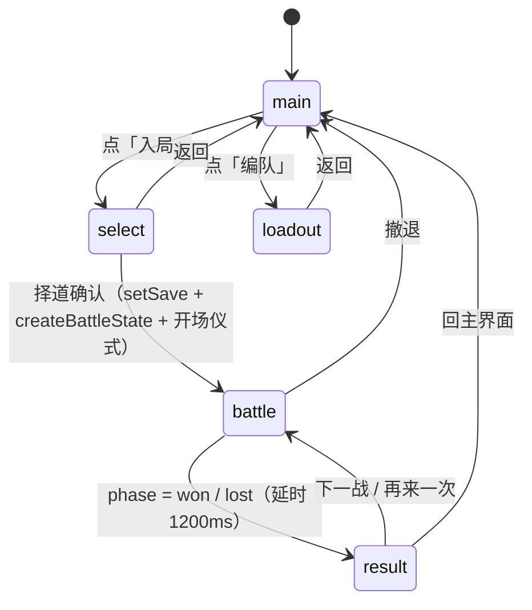

# 《炁渊 · QI ABYSS》当前进展

| 项目 | 内容 |
|---|---|
| **文档性质** | **现状快照（每次收尾整体刷新）**。不是台账、不是计划。刷新时整篇重写，不保留旧版本痕迹 |
| **更新日期** | 2026-10-23 |
| **读者** | 接手这个项目的人（含三个月后的你） |
| **以代码为准** | 本文所有规模、结构、完成度陈述均来自 `src/`、`public/`、`scripts/`、`git log` 的实测。与任何其他文档冲突时，**以代码为准** |
| **配套文档** | 历史交付见 `docs/已完成-历史交付.md`；未做事项见 `docs/待做项.md` |

---

## 一、一句话现状

**一个能完整玩通单局、可构建可测试的手机竖屏卡牌对战 Demo：战斗系统与战斗界面已实装且拆分干净，外围五屏只有骨架，六个新界面与主界面美化全部未开工。**

再展开一层：

- **能玩的**：主界面 → 择道 → 战斗 → 结算 闭环成立，三大架势、双脉炁、弹反、奥义融合、破绽、归墟弃牌、装备附魔全部可触发。
- **能信得过的**：102 条测试、四层守卫（L1 类型 / L2 数据 / L3 契约 / L4 构建）全绿；`git` 14 个提交、代码 13,812 行。
- **还不能交付的**：仓库仍是 public（认证否决项）；代码文件 63 个、提交 14 个，离「可认证项目」的规模门槛有明显差距；主界面与新界面未动。

---

## 二、规模指标

| 指标 | 数值 | 口径 / 来源 |
|---|---|---|
| 技术栈 | Vite 8 + React 19 + TypeScript 6 + oxlint + vitest | `package.json`；**零第三方 UI 库、零状态管理库** |
| 代码文件 | **63 个**（ts 32 / tsx 28 / mjs 3），含 4 个测试文件 → **非测试 59 个** | `git ls-files` 按扩展名统计 |
| 代码行数 | 非测试 **11,739** 行 + 测试 **2,073** 行 = **13,812** 行 | `wc -l` 全量 |
| 测试 | **102 passed**（battle 58 / contract 33 / i18n 10 / diag 1） | `npm test` |
| 提交数 | **14 个**（2026-09-10 ~ 2026-09-17） | `git log` |
| 已跟踪文件 | **153 个** | `git ls-files \| wc -l` |
| 素材 | **51 张 PNG**（bg 2 / card 8 / char 3 / enemy 6 / ui 32）+ 3 册提示词 + 2 mermaid + 2 css | `ls public/art` |
| 文档 | `docs/` 下 9 份 md（约 6,150 行）+ 7 件验收截图 | `wc -l docs/*.md` |
| 构建产物 | 384.47 kB / gzip 118 kB | `npm run build` |
| 零第三方 UI | 组件全部手写在 `src/components/`；样式靠 `tokens.css` + `global.css` | `package.json` 依赖只有 react / react-dom |

---

## 三、架构现状

### 3.1 界面状态机（`src/App.tsx`）



- `type Screen = 'main' | 'loadout' | 'select' | 'battle' | 'result'`（`src/App.tsx:16`）。
- **五屏平铺、单 `useState` 驱动**，没有路由、没有嵌套状态机。新增界面 = 在这个联合类型里加一个成员 + 在 `App` 的 JSX 里加一个分支。
- 战斗状态独立于 `Screen`：`useReducer(battleReducer)` 持有整局 `BattleState`；`Screen` 只管「现在显示哪一屏」。
- 胜负跳转靠 `useEffect` 观察 `battle.phase`，延时 1200ms 让死亡动效播完再切屏。

### 3.2 目录树（真实结构 + 职责）

```
src/
├── App.tsx                      207 行  五屏编排、存档读写、建局回调、覆盖层挂载
├── main.tsx                       9 行  React 挂载入口
├── game/                                —— 纯逻辑层（不含任何 React）
│   ├── types.ts                 609 行  全部数据契约：BattleState / Combatant / Card / Enemy / Status / 判别联合
│   ├── constants.ts             257 行  数值唯一真源（弹反窗口、炁上限、伤害系数、HAND_LIMIT…）
│   ├── audio.ts                         SFX 播放层，**只能被 UI 调用**，缺文件静默
│   ├── data/                            纯数据表（无逻辑）
│   │   ├── actors.ts            183 行  角色 / 敌人 / 战役
│   │   ├── cards.ts             109 行  卡牌 / 装备 / 附魔组合
│   │   ├── statuses.ts           80 行  STATUS_BEHAVIOR（状态 → 行为 + labelKey）
│   │   └── world.ts             309 行  架势 / 十神 / 节气 / 月令 / 术语
│   └── engine/                          纯函数引擎（可单测、确定性）
│       ├── battle.ts           1615 行  回合状态机、出牌、结算、归墟、弹反判定、调和、reducer
│       ├── damage.ts            458 行  resolveDamage 管线 + DamageModifier 链
│       ├── hooks.ts              96 行  节气钩子调度，**全引擎唯一读 solarTermId 的地方**
│       ├── rng.ts                        mulberry32，state.rngState 驱动
│       ├── assertNever.ts                 穷尽性检查
│       ├── battle.test.ts      1108 行  58 条战斗用例
│       ├── contract.test.ts     768 行  33 条不变量断言（A1–A7）
│       └── diag.test.ts                   1 条诊断用例
├── components/                          —— 视图层（React）
│   ├── Screens.tsx              886 行  AmbientBackground / MainScreen / LoadoutScreen / ResultScreen / IntroSequence
│   ├── BattleScreen.tsx         258 行  战斗屏编排（原 2147 行，已拆分）
│   ├── StanceSelectPanel.tsx    228 行  择道面板（Screen='select'）
│   ├── RelicPhase.tsx           504 行  归墟弃牌面板（'relic' 相位专用）
│   ├── battle/                   23 个文件  战斗屏子组件 + 3 个 hook + 3 个纯工具
│   ├── fx/                       Effects.tsx 653 行 + readToken.ts（Canvas 取色唯一入口）
│   ├── ui/                       Primitives.tsx 384 行 + Tip.tsx 122 行（通用件 / 释义浮层）
│   └── svg/                      Figure.tsx 243 行（立绘兜底）+ Glyphs.tsx 261 行（图标）
├── i18n/                                —— 文案层
│   ├── locales/zh-CN.ts         373 行  唯一语言包（label / ui / tip 三段）
│   ├── t.ts / interpolate.ts           取值与插值
│   ├── keys.ts                          枚举值 → 文案键的显式映射表（禁止动态拼接）
│   ├── locale-store.ts                  LOCALES / DEFAULT_LOCALE
│   ├── save-migration.ts         45 行  存档版本平滑迁移
│   └── i18n.test.ts             169 行  10 条（键完备 / 孤儿键 / 插值）
└── styles/
    ├── tokens.css                        **全项目唯一允许写颜色字面量的文件**
    └── global.css                        全局类、动画
```

### 3.3 引擎分层（四层，边界是硬的）

| 层 | 文件 | 允许做什么 | 禁止做什么 |
|---|---|---|---|
| L-契约 | `types.ts` | 定义全部数据结构、判别联合、`Record<…>` 完备表 | 不含任何逻辑 |
| L-数值 | `constants.ts` | 所有魔法数字的唯一出处 | 不含业务分支 |
| L-数据 | `data/*.ts` | 声明式数据表，用 `satisfies readonly X[]` 让 `tsc` 校验 | 不 import 引擎，不写战斗逻辑 |
| L-引擎 | `engine/*.ts` | 纯函数：`(state, action) → state` | **禁 `Math.random` / `Date.now`**（走 `state.rngState`）；禁读 `solarTermId`（只 `hooks.ts` 例外）；不 import React |

- 确定性由 `mulberry32(state.rngState)` 保证，所以同一 seed + 同一操作序列 → 同一结果，测试才能断言具体数字。
- 视图层单向依赖引擎：`components/` → `engine/`，反向零引用。

---

## 四、可运行性

| # | 命令 | 作用 | 2026-10-23 实测 |
|---|---|---|---|
| 1 | `npm install` | 安装依赖 | 正常 |
| 2 | `npm ci --dry-run --offline` | 校验锁文件完整、可离线复现 | **退出码 0**，本地缓存 1 秒解析 **67 个包** → 锁文件完整，无隐式网络依赖 |
| 3 | `npm run dev` | 本地开发（vite，390×844 竖屏容器） | 正常 |
| 4 | `npm run build` | `guard` → `tsc -b` → `vite build` 三段串联 | 通过，384.47 kB / gzip 118 kB |
| 5 | `npm test` | `vitest run` | **102 passed** |
| 6 | `npm run guard` | 架构守卫 8 项检查 | **0 error / 32 warning** |
| 7 | `npm run lint` | `oxlint` | **0 error / 11 warning** |
| 8 | `node scripts/界面核验.mjs` | 三相截图（齐全 / 降级 / 对照） | 产物在 `docs/验收截图/` |

**注意**：`npm run build` 里 `guard` 排在 `tsc` 前面，所以守卫报 error 时构建会在类型检查之前就失败——这是刻意的，防止「类型过了但架构破了」的提交混进产物。

---

## 五、功能完成度矩阵

| 系统 | 状态 | 代码依据 | 缺口 |
|---|---|---|---|
| **双脉炁** | 已实装 | `constants.ts` `QI_CAP_BASE=14` / `QI_REGEN_YANG=3` / `QI_REGEN_YIN=3`；`battle.ts` `regulateOutcome()` 是调息**单一真源** | 无 |
| **弹反** | 已实装 | `battle.ts:1004` `judgeParry(elapsedMs)` 纯函数；`PARRY_TELEGRAPH_MS=350` + `PARRY_WINDOW_MS=700` = 1050ms；`PARRY_COUNTER_MUL=0.5` | UI 手感靠 `useParryTiming` 报时间戳，无自动化手感测试 |
| **奥义融合** | 已实装 | `canFuse()`（禁奥义链式）/ `fuseCards()` / `ULTIMATE_MUL=1.5`；**唯一入口 = 操作栏按钮**，手牌严格单选 | `Card.fusedFrom` 字段存在但无消费点（见技术债） |
| **破绽** | 已实装 | `FLAW_COMBO_THRESHOLD=3` / `FLAW_COUNTER_THRESHOLD=1` / `FLAW_DURATION=1`；结算见 `battle.ts:597`，消耗见 `battle.ts:797` | 无 |
| **三大架势** | 已实装 | `STANCES`（体修·连击蓄势 / 法修·五行轮转 / 散修·以柔克刚）；`substituteRatio` 2 / 2 / 1 | 架势切换只在入局前（择道面板），战斗中不可换 |
| **装备附魔** | 已实装 | `cards.ts` `ENCHANT_COMBOS` + `findCombo()`（双向查找）；`battle.ts:890` 采纳；`Equipment.qiCapSide` 必填 | 附魔只影响数值与状态挂载，无专属动效 |
| **五层变量** | **部分** | 月令（`LUNAR_MONTHS` wxBonus / defMul / spellCostDelta）、节气、架势、装备均生效；十神 10 条中 **4 条 `implemented:false`**（偏印 / 正官 / 比肩 / 劫财） | 十神实装 6/10；「失令」分支跑不到但逻辑存在 |
| **敌人势** | 已实装 | `Enemy.shi` / `shiCap`；`battle.ts:1095` 每回合蓄势；五行相克可打断 `chargeStacks`（`battle.ts:863`） | 势的界面表达只有 `ui_势条_格/填充` 两件素材 |
| **归墟弃牌** | 已实装 | `HAND_LIMIT=6`、`HAND_DRAW_CAP=10`（必须大于上限否则永不触发）、`phase='relic'`、`relicQiOf()`、敌方吞食弃牌加盾；UI 在 `RelicPhase.tsx` | 弃牌动画（`RelicFlows` / `RelicGhosts` / `RelicLotus`）已接，但无音效文件 |
| **节气** | **部分** | `world.ts` `SOLAR_TERMS` 24 条，**实装 8 条**（`IMPLEMENTED_TERMS` 过滤），其余 16 条 `implemented:false` 且 `hooks:{}` | 16 个节气是空壳；守卫 §7 保证「声称实装就不能是空 hooks」 |
| **i18n** | **部分** | S0 骨架 + S1 数据 + S5 存档已完成；`zh-CN.ts` 373 行；`i18n.test.ts` 10 条 | **S2 组件层 / S3 数据层 / S4 引擎日志未迁**，`guard` §9 登记 21 处中文台账 |

> **读法**：「已实装」= 有代码、有测试或守卫覆盖、玩家能触发；「部分」= 主干通了但存在明确缺口；「未实装」= 只在数据或类型里有位置。

---

## 六、界面清单

### 6.1 五个 Screen

| Screen | 组件与文件 | 行数 | 完成度 | 说明 |
|---|---|---|---|---|
| `main` | `MainScreen`（`Screens.tsx:72`） | 约 113 行 | **骨架**（可玩但未美化） | 标题 + 进度文案 + 入局 / 编队两按钮；`ui_面板底` 等通用件未接 |
| `loadout` | `LoadoutScreen`（`Screens.tsx:186`） | 约 436 行 | **基本可用** | 角色选择、双装备位、架势预览；无独立「命盘·编队」信息架构 |
| `select` | `StanceSelectPanel.tsx` | 228 行 | **已实装** | 选人即选架势，确认后建局（`1c4a77f` 交付） |
| `battle` | `BattleScreen.tsx` + `components/battle/` | 258 行 + 23 个文件 | **已实装**（最完整） | 顶部 / 架势 / 我方 / 敌方 / 手牌 / 操作栏 / 弹反区七区拆分完毕，29 张素材接入 |
| `result` | `ResultScreen`（`Screens.tsx:623`） | 约 132 行 | **部分** | 8 行统计 + 十神触发块 + 下一战 / 再来 / 回主界面三按钮；**无奖励条、无命理复盘** |

### 6.2 覆盖层与常驻层

| 层 | 文件 | 行数 | 作用 |
|---|---|---|---|
| 归墟面板 | `RelicPhase.tsx` | 504 行 | `phase='relic'` 时的弃牌界面，含化炁提示与敌方吞食预警 |
| 开场仪式 | `IntroSequence`（`Screens.tsx:767`） | 约 120 行 | 月令 / 节气 / 角色三行字幕，进战斗前播 |
| 氛围背景 | `AmbientBackground`（`Screens.tsx:39`） | 约 32 行 | 主界面 / 编队共用的山水底 |
| 特效层 | `fx/Effects.tsx` | 653 行 | `FxLayer`（粒子）/ `DamageNumberLayer`（飘字）/ `ParryGlyph`（弹反字形）；`fuseBurst` 7 形态；`MAX_PARTICLES` = 260 / 96 / 0 |
| Canvas 取色 | `fx/readToken.ts` | 24 行 | `getComputedStyle` 读 `--color-*`，模块级缓存；失败回落 `transparent` |
| 释义浮层 | `ui/Tip.tsx` | 122 行 | 五行 / 状态 / 十神长文释义 |

### 6.3 `components/battle/` 内部分工（23 个文件）

| 类别 | 文件 |
|---|---|
| 纯工具（无 React） | `constants.ts`（`CARD_W=78` / `CARD_H=112` 等必须保值的魔法数字）、`handLayout.ts`（手牌收拢/展开步进）、`artAssets.ts`（`artUrl()` / `nineSlice()` / `SLICE` / `UI` 表） |
| Hook | `useHandInteraction.ts`（227 行，长按/拖拽/选中）、`useParryTiming.ts`、`useBattleFx.ts`（196 行，特效触发与节流） |
| 区段组件 | `TopBar` / `StanceBar` / `PlayerPanel` / `QiResource` / `EnemyZone` / `EnemyInfoPanel` / `IntentCard` / `GameCard` / `HandArea` / `OperationBar` / `ParryPanel` |
| 装饰组件 | `ArtLayer`（素材渲染 + 缺失降级）、`BattleBackdrop` / `BattleFlash` / `RelicFlows` / `RelicGhosts` / `RelicLotus` |

---

## 七、素材与音频现状

### 7.1 素材（51 张 PNG）

| 前缀 | 数量 | 用途 | 接入状态 |
|---|---|---|---|
| `bg_` | 2 | 主界面底 / 战场底 | 已接入 |
| `card_` | 8 | 卡面底（五行 5 + 物理 + 术法 + 功能 + 奥义） | 已接入（`GameCard`） |
| `char_` | 3 | 陆青崖 / 苏绛雪 / 谢无咎立绘 | 已接入 |
| `enemy_` | 6 | 六个心猿立绘 | 已接入 |
| `ui_` | 32 | 面板、按钮、血条、炁槽、势条、弹反区、状态图标、五行印、破绽标记等 | **29 件已接入；3 件零引用** |

**三件零引用**（`public/art/` 有文件，`src/**` 无引用）：

- `ui_面板底.png`（约 362×120，宣纸米白 + 描金宽边 + 四角云雷纹）
- `ui_面板底_玉.png`（玉色变体）
- `ui_描金分隔线.png`（约 362×9）

这三件是**主界面与六个新界面的打底件**，当前只是「已入库、待接入」状态，不是废料。

### 7.2 音频

- 代码层：`src/game/audio.ts` 提供 `playSfx(name, volume)`，`SFX_FILES` 登记 3 个键（`归墟_玉磬` / `化炁_气流` / `莲花_锃`）。
- 资源层：`public/audio/` **只有 `音效清单.md`，0 个音频文件**。
- 现状结论：**没有 BGM、没有音量设置、没有静音开关**；播放在缺文件时静默返回，不影响可玩性。
- 设计约束：`audio.ts` 只能被 UI 调用，绝不进 `engine`（引擎必须保持纯函数与确定性）。

---

## 八、技术债清单

> 每条都可用 `npm run guard`、`grep` 或直接读文件复现。

### P0（会让人改错地方 / 阻断交接）

| # | 现象 | 位置 | 影响 | 建议 |
|---|---|---|---|---|
| 1 | `Enemy.atk` 存在但敌方伤害走 `intents[].damage`，`atk` 无消费点 | `types.ts` / `data/actors.ts` | 改 `atk` 不生效，误判为「数值改了没反应」 | 要么接进敌人平A，要么标 `@deprecated` 并删 |
| 2 | `Card.fusedFrom` 存在但 `fuseCards()` 不消费 | `types.ts` / `battle.ts` | 误以为融合有溯源加成 | 删除或接到结果页「本局融合次数」 |
| 3 | `StatusBehavior.affects` 存在但伤害管线不读，实际由 `EFFECT_HANDLERS` 承担 | `data/statuses.ts` | 两套「真相」，改一处不生效 | 删除字段，或在 `EFFECT_HANDLERS` 里断言一致性 |
| 4 | 文档漂移：`系统架构.md` 称「美术资源为零 / Tailwind v4 / useSyncExternalStore 自建 Store」 | `docs/归档/系统架构.md` | 接手者按错的技术栈读代码 | **已归档（2026-10-23）**，页首有声明 |
| 5 | 5 个零引用常量，对应数值在 `battle.ts` 内联成字面量 | `constants.ts`：`POJUN_LAYERS` / `SHISHEN_BONUS_HITS` / `SHISHEN_HIT_MUL` / `PIANCAI_DRAW_RATE` / `SUBSTITUTE_RATIO_SANXIU` | 改常量不生效（数值非单一来源） | 把内联字面量换回常量引用 |

### P1（阻碍下一阶段）

| # | 现象 | 位置 | 影响 | 建议 |
|---|---|---|---|---|
| 6 | i18n S2 / S3 / S4 未迁移：21 处中文台账 | `components/*`、`data/*`、`engine/battle.ts` `damage.ts`、3 个测试文件 | 无法加第二语言；文案与逻辑耦合 | 按 S2 → S3 → S4 顺序迁，每批跑 `guard` §9 看台账下降 |
| 7 | 3 处死 keyframe（`breathe` / `telegraphSweep` / `fuseRingPulse`） | `styles/global.css` | 无功能影响，但守卫持续报 ⚠ | 删除定义或重新挂 `animation` |
| 8 | 21 处 `hex` 豁免（`Effects.tsx` 14 + `Screens.tsx` 4 + `global.css` 3） | 同上 | 破坏「颜色只有 tokens.css 一个来源」 | `Effects.tsx` 已由 `readToken` 铺路，逐步替换；`Screens.tsx` 与 `global.css` 待拍板 |
| 9 | 三件通用件零引用 | `public/art/` | 素材闲置，主界面无法开工 | 见 `docs/待做项.md` B-06 |
| 10 | 音频无 BGM / 音量 / 静音 | `audio.ts` / `public/audio/` | 体验缺失，不影响可玩 | 先做静音开关与音量滑杆，BGM 后置 |

### P2（结构整洁度）

| # | 现象 | 位置 | 影响 | 建议 |
|---|---|---|---|---|
| 11 | `Screens.tsx` 886 行，四个屏挤在一个文件 | `components/Screens.tsx` | 改主界面要在 886 行里找 | 按 `battle/` 的先例拆目录 |
| 12 | `artAssets.ts` 在 `battle/` 下，却服务全局（`App.tsx` 也 import `UI.dmgBackdrop`） | `components/battle/artAssets.ts` | 目录语义错位，新人找不到 | 迁到 `components/ui/artAssets.ts` |
| 13 | `Effects.tsx` 653 行 | `components/fx/` | 七种融合形态挤在一个文件 | 按形态拆，或抽 `bursts.ts` |
| 14 | 主界面进度文案「已通关 X / 4 场」的 `4` 是硬编码 | `Screens.tsx` | 加战役即漂移 | 换 `CAMPAIGNS.length` |
| 15 | 16 个节气 `implemented:false` 但 `desc` 已写明效果 | `data/world.ts` | 文案承诺了引擎没有的机制（此前已修过白露一例） | 未实装节气的 `desc` 统一加「（未实装）」 |

---

## 九、已知限制与「不要误修」清单

> 这些是**刻意的设计决定**，不是 bug。改动前先读注释。

1. **玩家灼烧保底 1 血。** `battle.ts:456` 用 `Math.max(1, …)`：DOT 不直接击杀玩家，避免读条式暴毙。**不要**「顺手改成 0」。
2. **敌方灼烧可以杀敌，且会补判胜负。** `battle.ts:466` 用 `Math.max(0, …)`，回合开始结算完立即 `checkEnd`。若有人报「灼烧杀不死敌人」，先确认版本——这是 `31f6699` 已修的 P0，现版本是**能**杀死的。
3. **`enemyPos` 刻意用全量敌人（含已阵亡者）算坐标。** `battle.ts:114`：UI 会把阵亡敌人留在场上（降透明 + 灰度），只按存活者算下标会让伤害数字与立绘错位。
4. **`cascaded` 数组与 `MAX_CASCADE_DEPTH` 已删除，不要加回来。** `battle.ts:1277` 记录：早期版本有这层「防死循环保护」，但从来没有任何分支往 `cascaded` 里 push——整段是死代码，保护实际不存在。真正的链式限制在 `canFuse()`。
5. **白露霜寒「多段不按段叠层」是刻意的。** `world.ts:190`：实际是「每个被命中的目标各 +1 层」，层数靠多次出牌积累，与段数无关。旧文案写「2 段 → 2 层」是界面在骗人，已改文案而不是改引擎。
6. **`HAND_DRAW_CAP (10) > HAND_LIMIT (6)` 必须保持。** 否则抽牌阶段就把手牌压到上限内，回合结束永远不超限，归墟机制等于不存在。
7. **`CARD_W = 78` / `CARD_H = 112` / 收拢步进 / 选中上浮 `-58px` / `scale(1.12)` 是必须保值的魔法数字。** 改任一个都会让手牌区与素材底、操作栏错位。
8. **`Effects.tsx` 的 14 处 `hex` 是已登记的豁免，不得增加。** Canvas 2D 不能直接消费 CSS 变量；新代码一律走 `readToken()`。
9. **`assertNoIllegalAddBase`：`addBase` 只有装备可用。** 卡牌/节气/架势一律不准碰基础值（「性命双修」铁律）。
10. **十神 4 条未实装、节气 16 条未实装，是数据层状态，不是漏写。** 守卫 §7 会拦住「声称实装但 hooks 为空」的提交。

---

## 十、文档体系索引

### 10.1 三份主文档（以此为唯一日常入口）

| 文档 | 性质 | 什么时候看 |
|---|---|---|
| `docs/当前进展.md`（本文） | 现状快照，每次收尾整体刷新 | 接手第一天；每次开工前确认「现在到哪了」 |
| `docs/已完成-历史交付.md` | 交付台账，只追加不改写 | 想知道「这个东西为什么长这样」；准备认证材料 |
| `docs/待做项.md` | 唯一待做入口 | 决定下一步做什么；评审排优先级 |

### 10.2 归档文档（只读，不再更新）

| 文档 | 说明 |
|---|---|
| `docs/归档/待做项-主界面与新界面.md` | 原 1035 行待做清单，已被 `docs/待做项.md` 重组吸收。**保留作为需求原始出处**，新增待做不进此文件 |
| `docs/归档/战斗界面修复方案.md` | T01–T09 + R3 的施工方案，8 项已全部交付（`1c4a77f`） |
| `docs/归档/战斗界面接入与拆分方案.md` | 战斗屏 2147 → 259 行的拆分方案，已交付（`bd53593` + `18cd304`） |
| `docs/归档/产品需求.md` / `系统架构.md` / `交付说明.md` | 设计期文档，见下表 10.3 |

### 10.3 已归档的过时文档（**不要直接信任**）

| 文档 | 漂移点 | 处置 |
|---|---|---|
| `docs/归档/系统架构.md`（1404 行） | 技术栈写 Tailwind v4 + 自建 Store；称「美术资源为零」；`ResultScreen` 奖励条渲染位不存在 | **已归档（2026-10-23）**，只作历史意图记录 |
| `docs/归档/交付说明.md`（181 行） | 通篇按「已实现」描述，未标未实装项 | 同上 |
| `docs/归档/产品需求.md`（595 行） | 弹反窗口、装备数值、敌人名、战役结构与实现有出入 | 同上 |

### 10.4 仍然可信的文档

| 文档 | 为什么可信 |
|---|---|
| `docs/架构决策说明.md`（294 行） | 记录决策理由（为什么这么做），不描述现状，因此不易漂移 |
| `docs/设计哲学.md`（576 行）+ `.pdf` | 设计原则，与实现解耦 |
| `docs/玩法介绍.md`（1186 行）+ `.pdf` | 逐条对照过引擎；仍有少量描述待复核，但主干正确 |
| `docs/时序图.mermaid` / `docs/类图.mermaid` | 与 `engine/` 的分层一致 |
| `docs/验收截图/` | `scripts/界面核验.mjs` 的真实产物，可视作证据 |

---

## 附：刷新本文时的检查清单

每次收尾刷新本文，逐项确认：

1. 重跑 §四 八条命令，更新结果列。
2. 重跑 `git ls-files | wc -l`、`wc -l` 两套行数，更新 §二。
3. 若新增/删除 Screen，更新 §3.1 状态机与 §六 界面清单。
4. 若迁移了 i18n 某批，更新 §五 i18n 行与 §八 债务 6。
5. 若接了通用件或新增素材，更新 §七 素材表与「零引用」清单。
6. 若修掉某条技术债，从 §八 **删除该行**（本文是快照，不留历史——历史在台账里）。
7. 刷新页首「更新日期」。
